# RFM Customer Segmentation & Autumn CRM Campaign Plan

RFM segmentation of 1.36M H&M customers from 31.8M real transactions (2018-09 to 2020-09), turned into a budget-limited autumn campaign: who gets what, when, through which channel, what it costs, and how a holdout will measure it. DuckDB SQL + Python, Streamlit demo, standalone HTML report.

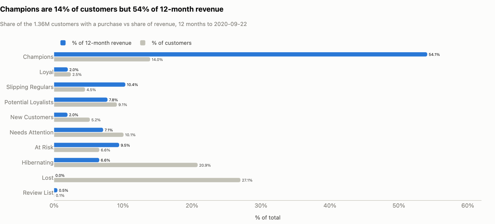

**What each segment gets this autumn** (expected 90-day net profit at base-case planning assumptions):

<!-- BEGIN:campaign_short -->
<!-- generated by `python run.py --steps docs` from the pipeline outputs; edit src/rfm/docgen.py, not this block -->

| Audience                        | Action                                          | When                                          | Channel                           | Category focus                                  | Discount   | Expected net (CU)   |
|:--------------------------------|:------------------------------------------------|:----------------------------------------------|:----------------------------------|:------------------------------------------------|:-----------|:--------------------|
| Champions                       | Autumn early access                             | 2020-09-29, two days before the public launch | Email + app message (subscribers) | their own usual categories                      | none       | +8.7K               |
| Loyal                           | Basket-building picks                           | Week 2 (from 2020-10-05)                      | Email + app message (subscribers) | Accessories (179), Jersey Basic (148)           | none       | +0.6K               |
| Slipping Regulars               | Purchase-cycle reminder: autumn picks           | Week 1 (2020-09-28), reminder day 10          | Email + app message (subscribers) | their own usual categories                      | none       | +7.9K               |
| Potential Loyalists             | Complete-the-look recommendations               | Week 1 (from 2020-09-28)                      | Email + app message (subscribers) | Sport dept. (126)                               | none       | +9.4K               |
| New Customers                   | Welcome journey                                 | Starts day 7 after the first order            | Email + paid social               | Swimwear (141), Sport dept. (124)               | none       | +3.4K               |
| New Customers                   | Welcome journey + 10% off 2nd order (test cell) | Same as the journey (parallel cell)           | Email + paid social               | Swimwear (141), Sport dept. (124)               | 10%        | -15K                |
| Needs Attention                 | Summer-to-autumn new-arrivals edit              | Week 1 (from 2020-09-28)                      | Email + app message (subscribers) | Swimwear (184)                                  | none       | +9.9K               |
| At Risk, 121-180 days           | Win-back content (email only)                   | Week 1 (from 2020-09-28)                      | Email (subscribers only)          | their own usual categories                      | none       | +3.6K               |
| At Risk, 181-364 days, 200+ CU  | Win-back content + paid social                  | Week 1 (from 2020-09-28)                      | Email + paid social               | Outdoor (165), Knitwear (155)                   | none       | +3.0K               |
| At Risk, 181-364 days, 200+ CU  | Win-back + 10% off (test cell)                  | Week 1, in parallel with the content cell     | Email + paid social               | Outdoor (165), Knitwear (155)                   | 10%        | -5.8K               |
| At Risk, 181-364 days, < 200 CU | Win-back content (email only)                   | Week 1 (from 2020-09-28)                      | Email (subscribers only)          | Knitwear (162), Menswear dept. (128)            | none       | +0.5K               |
| Hibernating                     | One 'new season' email                          | Week 4 (from 2020-10-19), with the Lost email | Email (subscribers only)          | Under-, Nightwear (128)                         | none       | +3.4K               |
| Lost                            | One reactivation email                          | Week 4 (from 2020-10-19)                      | Email (subscribers only)          | Baby/Children dept. (330), Menswear dept. (125) | none       | +3.3K               |
| Review List                     | no offers or paid media until reviewed          | -                                             | -                                 | -                                               | -          | -                   |

Expected net: 90-day net profit under base-case planning assumptions, not a measurement. Rollout total +53K CU (pessimistic +2.2K, optimistic +239K). Category focus: the categories the audience over-indexes on; the number in brackets compares the category's share of the audience's spend with its share for all customers (100 = average, 126 = 26% higher).

<!-- END:campaign_short -->

---

## The business question

The CRM Manager asked: *"The autumn campaign budget is limited. Who are the high-value customers we need to keep, who is about to churn and needs winning back, and who only buys online and never comes into a store? Give me segments, a recommendation per segment, and how we will measure whether this campaign worked."* Clarified questions, decision maker and decision points: [docs/01_request_and_scope.md](docs/01_request_and_scope.md).

## Three findings

1. **High value is concentrated and does not need discounts.** Champions are **14% of customers and 54% of 12-month revenue**; the 41K VIPs (1,000+ CU a year, 3% of customers) bring in **28%**. 83% of Champions buy again within 90 days with business-as-usual contact only, so a discount would mostly pay for orders we get anyway.
2. **Two groups are drifting away.** **89.8K At Risk customers** (6.6%; used to buy often or a lot, quiet for 4-12 months) are expected to spend **3.7M CU in the next 90 days instead of 5.8M at their usual pace**, and about 59K of them (65%) are expected not to buy at all. **61.7K Slipping Regulars** (frequent buyers already 61-120 days quiet, 10.4% of revenue) show a further 1.0M CU gap. Much of these gaps is natural slowdown: the plan expects about **45K CU** of incremental revenue from At Risk (about 26K from the content emails, plus 19K from a 10% offer test cell that is expected to lose money on its own), and measures it instead of promising the gap.
3. **Online-only is not a problem to fix.** **483K active customers (49%)** had no identified store purchase in 12 months. Their higher spend per customer is mostly basket size: an online order is about twice a store order even for the same customers (70 vs 33 CU), and they come back slightly *less* often (64% vs 69% at 5-9 orders). Nothing supports paying to push them into stores; channel decides the message.

## Recommendation

- **Content-led autumn wave** for every segment worth contacting: early access for Champions, purchase-cycle reminders for Slipping Regulars, a welcome journey for New Customers, a win-back for At Risk that leads with knitwear and outerwear for those who last bought in autumn / winter and with each customer's own top categories for those who last bought during the spring closure, one low-cost email each to Hibernating and Lost, no offers to the Review List until reviewed. Rollout cost **13.5K CU**.
- **Discounts only where they can pay, and only as tests:** 10% off a New Customer's second order, and 10% off for long-lapsed high-value At Risk customers, each in a cell sized to give a clear answer. A 20% offer and a Loyal voucher were considered and rejected (break-even lifts of 14 and 12 points).
- **Budget ask 61.9K CU.** Expected rollout net **+53K CU** on planning assumptions (pessimistic +2.2K, optimistic +239K); the test cells are expected to cost 21K CU, the price of learning whether offers pay.
- **Measure everything against the same 10% holdout in every audience.** The campaign-wide lift is detectable from 0.51 percentage points; offers scale in the next wave only if their measured lift clears break-even. Final read 2020-12-27.

Full plan and rules: [campaign_plan.md](docs/campaign_plan.md) · measurement: [measurement_plan.md](docs/measurement_plan.md) · audience spec: [segmentation_spec.md](docs/segmentation_spec.md) · one-page memo: [readout.md](docs/readout.md) · printable action plan: [reports/action_plan.html](reports/action_plan.html).

## Key charts

| | |
|---|---|
| 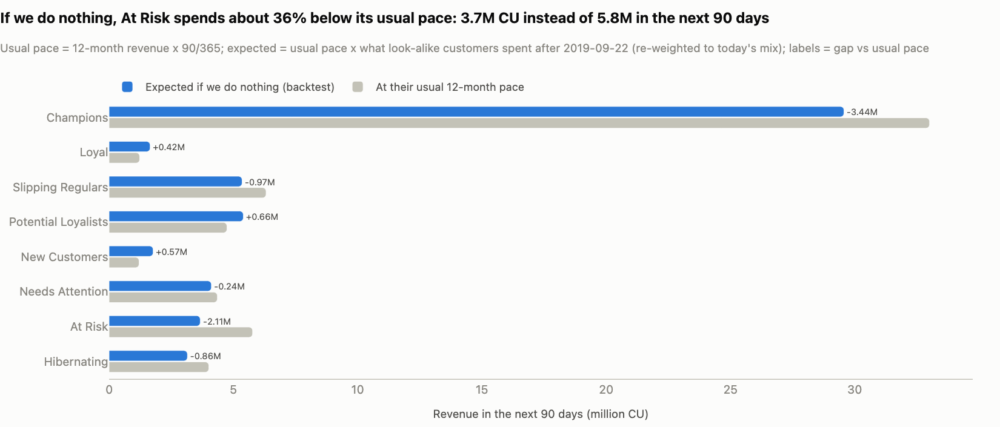 | 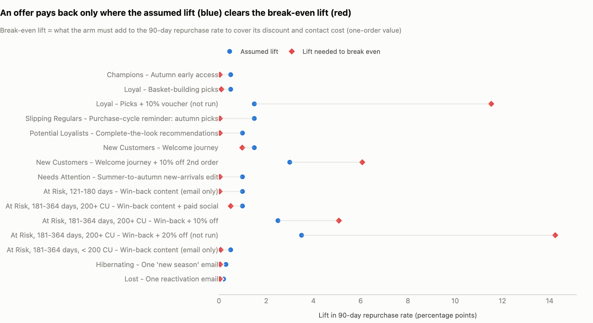 |
| 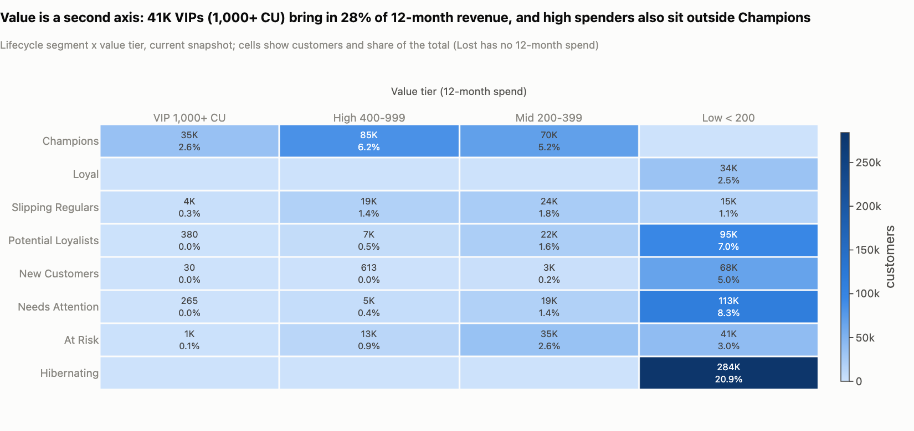 | 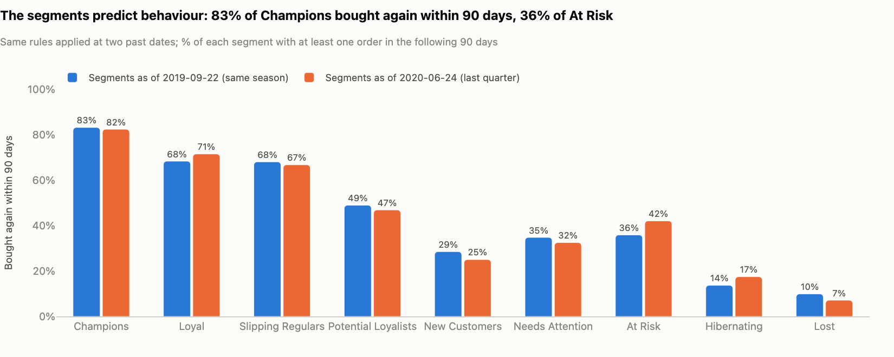 |
| 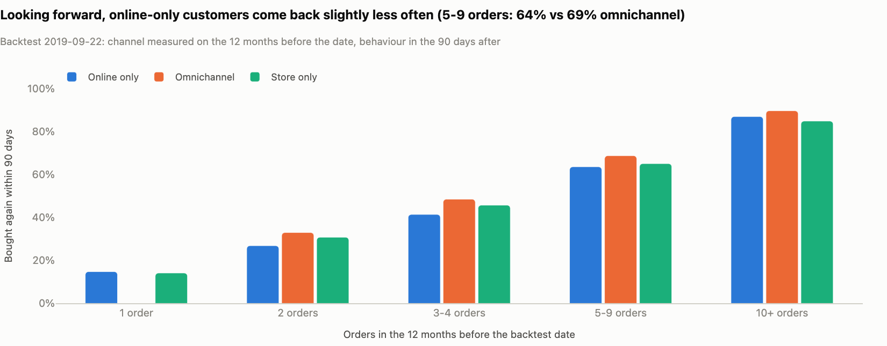 | 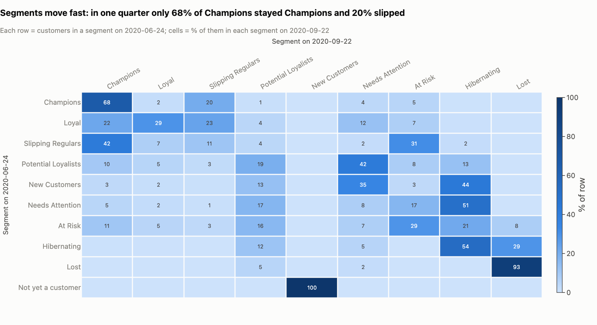 |

## The demo app (8 pages, in presentation order)

`streamlit run dashboard/app.py`. Each page starts with the question it answers and ends with a "How to read this" box. Pages 3, 6 and 7 recompute on the fly: re-segment 1.36M customers with your own thresholds, define your own at-risk audience, edit the campaign assumptions and budget.

| | |
|---|---|
| 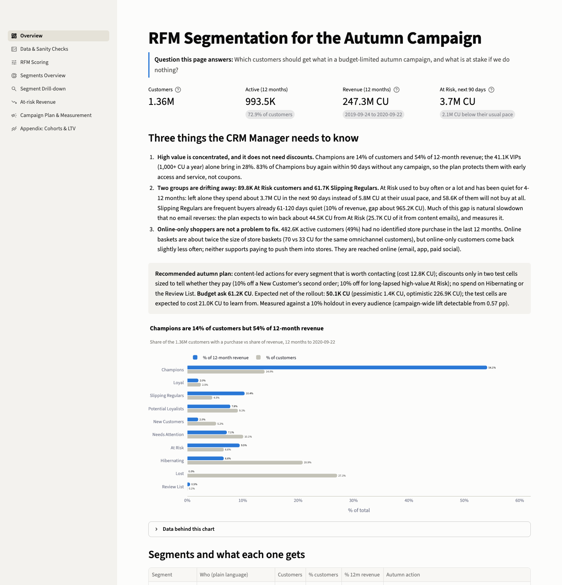 **1. Overview** | 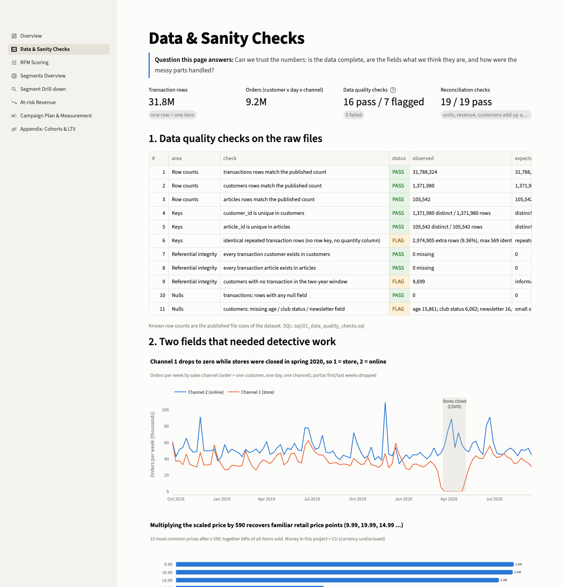 **2. Data & Sanity Checks** |
| 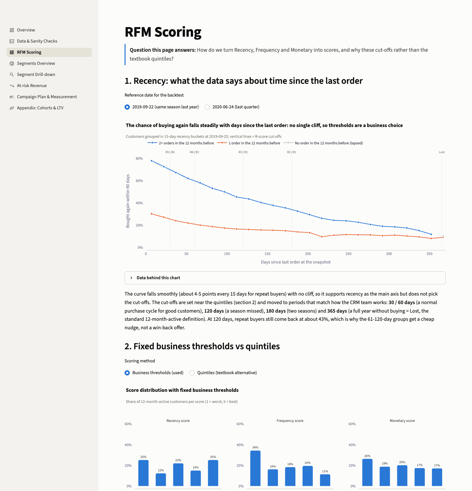 **3. RFM Scoring** | 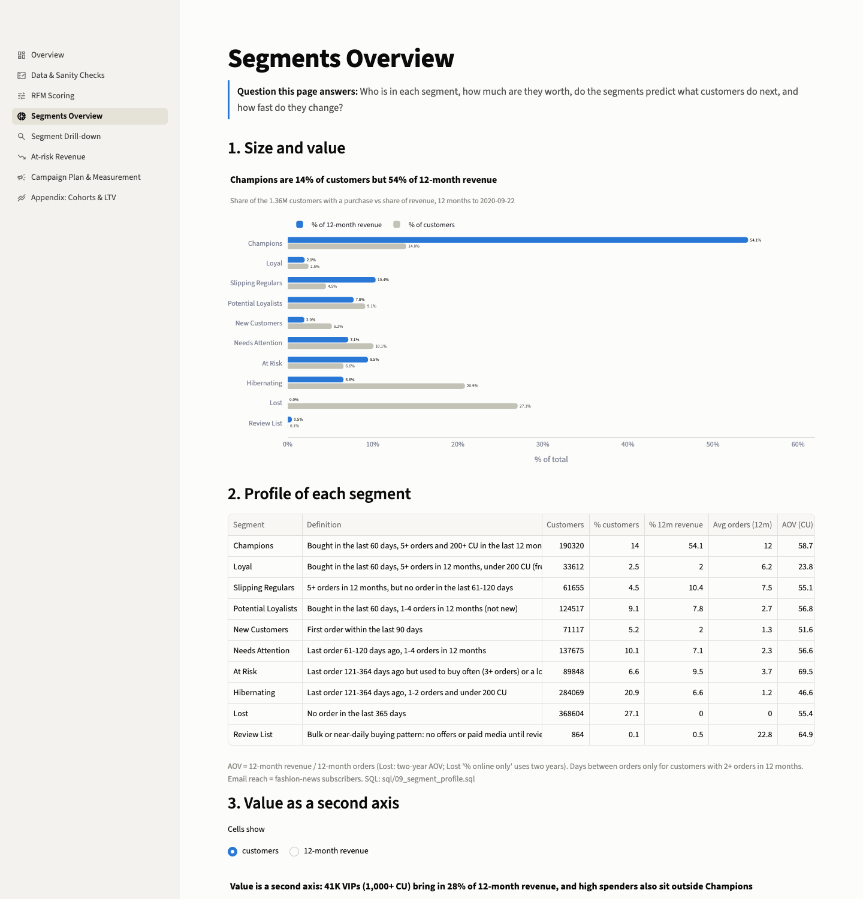 **4. Segments Overview** |
| 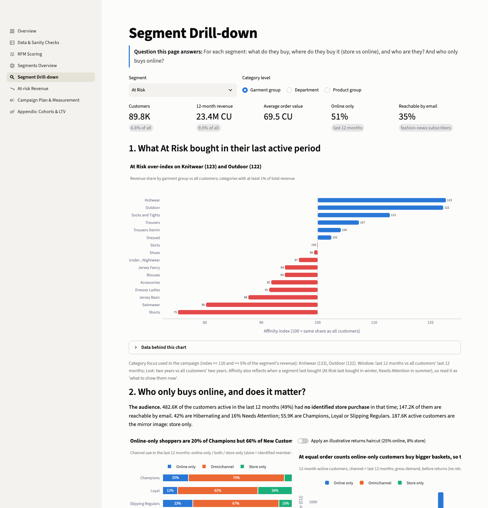 **5. Segment Drill-down** | 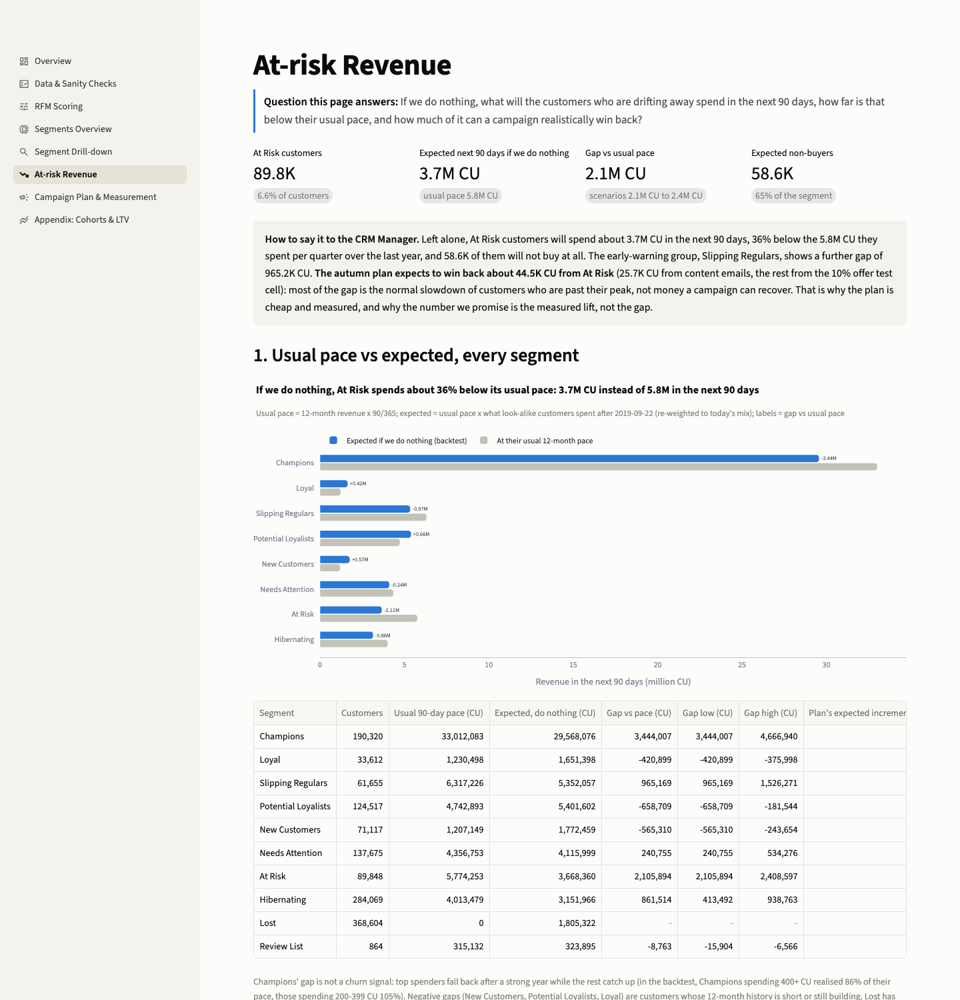 **6. At-risk Revenue** |
| 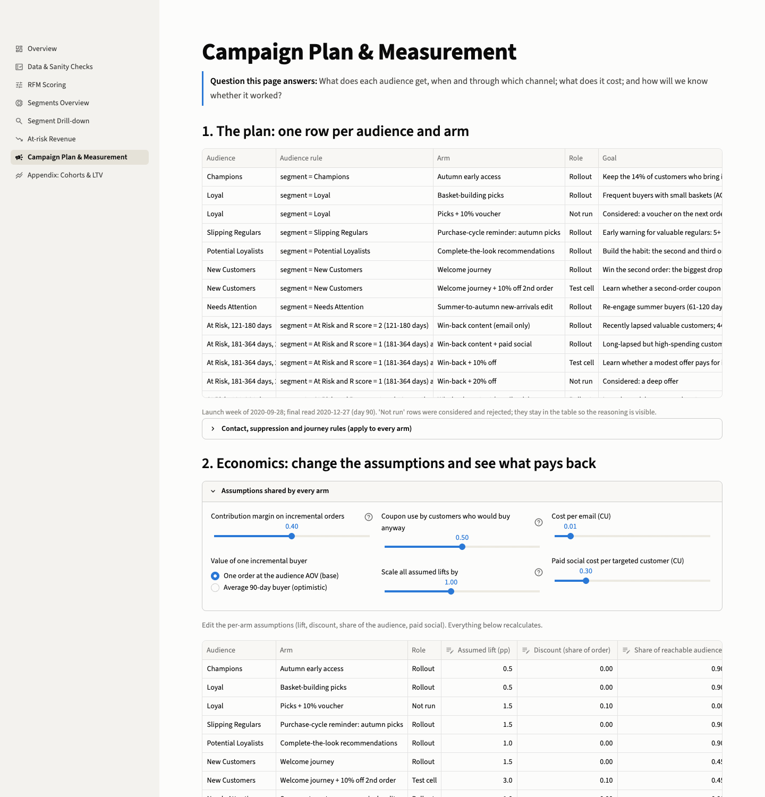 **7. Campaign Plan & Measurement** | 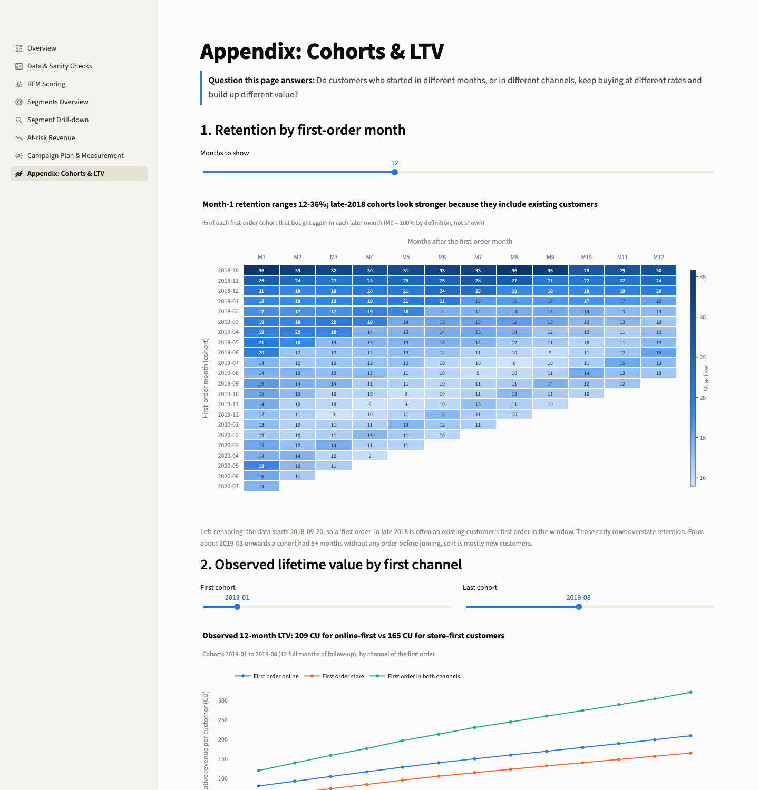 **8. Appendix: Cohorts & LTV** |

The same charts, with the full narrative, are in [reports/report.html](reports/report.html) (one file, opens offline). Notebook exports: [01 cleaning](reports/01_cleaning.html) · [02 RFM](reports/02_rfm.html) · [03 segments and actions](reports/03_segments_and_actions.html) · [04 cohorts](reports/04_cohort.html).

## Method and data

- **Data:** H&M Personalized Fashion Recommendations dataset (public, 2022): 31,788,324 item rows, 1,362,281 customers with an order, 105,542 articles, 2018-09-20 to 2020-09-22. All of it is processed with DuckDB; nothing is sampled.
- **Cleaning** ([03_data_quality_checks.md](docs/03_data_quality_checks.md)): 23 checks (16 pass, 7 flagged with a documented handling, 0 fail) and 19 reconciliation checks from raw rows to segments. Channel 1 = store, confirmed by the COVID store closures (no store sales 2020-03-20 to 2020-05-05). Money = **CU = price × 590** (every price lands on a retail price point; gross demand, no returns). Identical rows are extra units. 864 bulk or near-daily buyers go on a Review List (kept in totals, no offers).
- **RFM** ([02_metric_definitions.md](docs/02_metric_definitions.md)): snapshot 2020-09-22; Recency = days since last order; Frequency and Monetary over the trailing 12 months (order = customer × day × channel). Fixed thresholds (R 30/60/120/180 days, F 1/2/3-4/5-9/10+, M 50/100/200/400 CU): R and M sit near the active-customer quintiles (R 23/60/112/215 days, M 40/85/166/352 CU) and are set to business periods and round amounts, F is set by hand because a third of active customers have one order. K-Means was run as a cross-check and not used (no natural clusters; clusters move when refit).
- **Segments:** 9 lifecycle segments + Review List, plus a value tier (VIP / High / Mid / Low). Validated by applying the same rules at two past dates and checking what customers did next.
- **"If we do nothing":** same rules at 2019-09-22 (same season one year earlier), 90 days of observed behaviour, re-weighted to today's mix (recency × frequency × spend × channel); scenarios from the 2020-06-24 quarter and a pessimistic case.
- **Campaign economics:** an incremental buyer is worth one order at the audience's AOV, 40% contribution margin, coupons also used by customers who would buy anyway; break-even lift per arm; three scenarios.
- **Measurement:** randomised 10% holdout in every audience, intention-to-treat, 90-day repurchase rate as the primary KPI, test cells sized so a "no" is informative.

<!-- BEGIN:segment_summary -->
<!-- generated by `python run.py --steps docs` from the pipeline outputs; edit src/rfm/docgen.py, not this block -->

| Segment             | Rule (scores)                                                                                 | In plain words                                                                             | Customers     | % customers   | % 12m revenue   | AOV (CU)   | Orders / 12m   | Days between orders   | Main categories (share of spend)                      | Email reach   |
|:--------------------|:----------------------------------------------------------------------------------------------|:-------------------------------------------------------------------------------------------|:--------------|:--------------|:----------------|:-----------|:---------------|:----------------------|:------------------------------------------------------|:--------------|
| Champions           | R >= 4 and F >= 4 and M >= 4                                                                  | Bought in the last 60 days, 5+ orders and 200+ CU in the last 12 months                    | 190,320       | 14.0%         | 54.1%           | 58.7       | 12.0           | 33                    | Jersey Fancy 14%, Trousers 11%, Dresses Ladies 9%     | 47%           |
| Loyal               | R >= 4 and F >= 4 (remaining)                                                                 | Bought in the last 60 days, 5+ orders in 12 months, under 200 CU (frequent, small baskets) | 33,612        | 2.5%          | 2.0%            | 23.8       | 6.2            | 53                    | Jersey Fancy 15%, Under-, Nightwear 11%, Trousers 10% | 48%           |
| Slipping Regulars   | R = 3 and F >= 4                                                                              | 5+ orders in 12 months, but no order in the last 61-120 days                               | 61,655        | 4.5%          | 10.4%           | 55.1       | 7.5            | 40                    | Jersey Fancy 14%, Trousers 11%, Dresses Ladies 9%     | 44%           |
| Potential Loyalists | R >= 4 (remaining)                                                                            | Bought in the last 60 days, 1-4 orders in 12 months (not new)                              | 124,517       | 9.1%          | 7.8%            | 56.8       | 2.7            | 98                    | Jersey Fancy 15%, Trousers 12%, Under-, Nightwear 9%  | 38%           |
| New Customers       | tenure < 90 days                                                                              | First order within the last 90 days                                                        | 71,117        | 5.2%          | 2.0%            | 51.6       | 1.3            | 11                    | Jersey Fancy 15%, Trousers 12%, Swimwear 8%           | 33%           |
| Needs Attention     | R = 3 (remaining)                                                                             | Last order 61-120 days ago, 1-4 orders in 12 months                                        | 137,675       | 10.1%         | 7.1%            | 56.6       | 2.3            | 80                    | Jersey Fancy 14%, Trousers 11%, Swimwear 11%          | 37%           |
| At Risk             | R <= 2 and (F >= 3 or M >= 4)                                                                 | Last order 121-364 days ago but used to buy often (3+ orders) or a lot (200+ CU)           | 89,848        | 6.6%          | 9.5%            | 69.5       | 3.7            | 38                    | Jersey Fancy 13%, Trousers 12%, Knitwear 11%          | 35%           |
| Hibernating         | R <= 2 (remaining)                                                                            | Last order 121-364 days ago, 1-2 orders and under 200 CU                                   | 284,069       | 20.9%         | 6.6%            | 46.6       | 1.2            | 40                    | Jersey Fancy 14%, Trousers 12%, Under-, Nightwear 10% | 29%           |
| Lost                | recency >= 365 days                                                                           | No order in the last 365 days                                                              | 368,604       | 27.1%         | 0.0%            | 55.4       | 0.0            | -                     | Jersey Fancy 15%, Trousers 11%, Knitwear 9%           | 29%           |
| Review List         | >= 20 units of one article in an order, >= 100 units in an order, or purchases on >= 150 days | Bulk or near-daily buying pattern: no offers or paid media until reviewed                  | 864           | 0.1%          | 0.5%            | 64.9       | 22.8           | 21                    | Jersey Fancy 13%, Dresses Ladies 11%, Blouses 11%     | 37%           |
| **Total**           |                                                                                               | all customers with an order 2018-09-20 to 2020-09-22                                       | **1,362,281** | **100.0%**    | **100.0%**      |            |                |                       |                                                       |               |

Days between orders: median of each customer's average gap between orders in the 12 months, customers with 2+ orders only (for lapsed segments, the gap while they were still buying). Main categories: the three garment groups with the largest share of the segment's spend (12 months; two years for Lost). The largest categories are similar in every segment; what sets a segment apart is the category it over-indexes on, which the campaign uses as its category focus.

<!-- END:segment_summary -->

## Limitations

- Revenue is gross demand: the data has no returns (online returns are typically higher than store returns).
- Store purchases are only recorded when the member identifies, so "online only" means "no identified store purchase".
- Autumn 2020 is a COVID autumn; the backtests are autumn 2019 and the 2020 reopening summer. A second wave would change behaviour.
- Lifts, margin, coupon use and paid-social costs are planning assumptions until the holdout replaces them with measurements ([assumptions.md](docs/assumptions.md)).
- No order id (same-day online orders count as one order) and left-censoring (the first order in the data is not always the first ever).

## How to run

Requirements: Python 3.11+ (tested on 3.12), 16 GB RAM recommended (the data-quality step peaks at about 14 GB; with less memory, or other heavy jobs running, DuckDB spills to disk and that step can take a few minutes instead of 15 seconds), ~2 GB free disk for the Parquet files, Google Chrome for PNG export and screenshots.

```bash
make setup
```

```bash
make all
```

```bash
make dashboard
```

The raw H&M CSVs are read from `data.raw_dir` in [config.yaml](config.yaml) (default `~/projects/data-projects/datasets/p3-comp-hm-2020`). To point elsewhere without editing the config, copy `.env.example` to `.env` and set `HM_RAW_DIR=/path/to/folder`. No raw or derived data is committed (`data/` is gitignored); `make all` rebuilds everything: staging → data quality → marts → reconciliation → analysis → figures → report → notebooks → docs.

Other targets: `make test` (SQL/Python parity, every dashboard page, interactive controls), `make data`, `make notebooks`, `make screenshots`. Any single SQL file runs on its own: `python scripts/run_sql.py sql/05_customer_rfm.sql`. Last full run on the full 31.8M rows:

<!-- BEGIN:run_timings -->
<!-- generated by `python run.py --steps docs` from the pipeline outputs; edit src/rfm/docgen.py, not this block -->

| Step      | What it does                                                         | Seconds   |
|:----------|:---------------------------------------------------------------------|:----------|
| link      | point data/raw at the H&M files                                      | 0.0       |
| stage     | CSV to Parquet with DuckDB (31.8M rows)                              | 3.2       |
| dq        | 23 data-quality checks                                               | 139.5     |
| marts     | clean facts, RFM at three dates, backtests, profiles (SQL 02-12, 14) | 13.6      |
| reconcile | 19 reconciliation checks                                             | 0.6       |
| analysis  | do-nothing projection, campaign economics, K-Means check, metrics    | 30.4      |
| figures   | 16 PNG charts                                                        | 2.6       |
| report    | report.html and action_plan.html                                     | 1.5       |
| notebooks | execute notebooks 01-04 and export to HTML                           | 25.4      |
| **Total** | plus under a second to regenerate the doc tables                     | **216.8** |

<!-- END:run_timings -->

## Repository map

```
config.yaml            every parameter (snapshot, thresholds, exclusion rule, economics)
run.py / Makefile      one-command pipeline
sql/                   00-14 standalone DuckDB files (staging, checks, marts, RFM, backtests, flow) + rfm_single_query.sql
src/rfm/               segments (Python copy of the rules), analysis, campaign economics, power, charts, report, docgen
notebooks/             01_cleaning, 02_rfm, 03_segments_and_actions, 04_cohort (executed)
dashboard/             Streamlit app: app.py + views/
reports/               report.html, action_plan.html, notebook exports, figures/, metrics.json
docs/                  plan, scope, metric definitions, data quality, assumptions, segmentation spec,
                       campaign plan, measurement plan, readout
tests/                 parity of SQL and Python rules; every dashboard page renders
```
