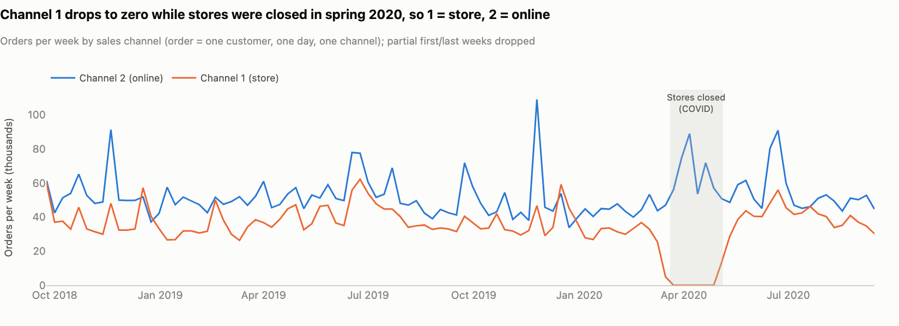
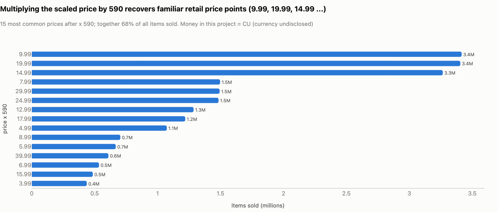

# 03 — Data quality checks

**Data source:** H&M Personalized Fashion Recommendations dataset (Kaggle, 2022): `transactions_train.csv` (31,788,324 item rows, 2018-09-20 to 2020-09-22), `customers.csv` (1,371,980 customers) and `articles.csv` (105,542 articles). Every row is processed; nothing is sampled.

**Summary.** 23 checks on the raw files: 16 pass, 7 are flagged as known issues with a documented handling, none fail. All 19 reconciliation checks pass: units, revenue, orders and customers are identical at every step from the raw rows to the segments. None of the flags changes a segment-level finding. The two that matter most for the campaign are the **Review List** (864 accounts held back from offers until reviewed) and the fact that all revenue is **gross demand** (the data has no returns).

Definitions used below (order, CU, Review List rule) are in [02_metric_definitions.md](02_metric_definitions.md).

---

## What was checked and why

| Layer | Question it answers | Where | Result |
|---|---|---|---|
| Raw-file checks | Are the files complete, do the keys join, and are the fields what we think they are? | `sql/01_data_quality_checks.sql` → `dq_checks.parquet` | 16 PASS / 7 FLAG / 0 FAIL |
| Reconciliation | Does every step from raw rows to segments keep exactly the same units, revenue, orders and customers? | `sql/13_reconciliation_checks.sql` → `reconciliation_checks.parquet` | 19 of 19 pass |
| Rule parity | Does the Python copy of the segment rules (used by the dashboard sliders) give the same answer as the SQL? | `tests/test_segments_parity.py` | same scores and segment for every customer at all three snapshots |

The raw-file checks are grouped by what could go wrong for this request:

- **Row counts and time range.** A short file or missing days would shrink every segment and look like churn.
- **Keys and referential integrity.** Every transaction must join to a customer and an article, or segment profiles and category mixes silently lose rows.
- **Nulls.** Missing attributes decide whether a customer counts as email-reachable.
- **Channel and price.** Both fields are encoded in the public file; they decide the online-only answer and every CU amount.
- **Extreme customers.** A handful of bulk buyers can distort Monetary and end up in an offer audience.

**Status:** PASS = as expected. FLAG = known issue; the handling column says what was done about it. FAIL = blocks the pipeline: `python run.py` stops after the check step, before any mart is built, and stops again after the reconciliation step if any total does not match.

---

## 1. Raw-file checks

<!-- BEGIN:dq_checks -->
<!-- generated by `python run.py --steps docs` from the pipeline outputs; edit src/rfm/docgen.py, not this block -->

| #   | Area                  | Check                                                                    | Status   | Observed                                                                                       | Expected                                           | Handling                                                                                                     |
|:----|:----------------------|:-------------------------------------------------------------------------|:---------|:-----------------------------------------------------------------------------------------------|:---------------------------------------------------|:-------------------------------------------------------------------------------------------------------------|
| 1   | Row counts            | transactions rows match the published count                              | PASS     | 31,788,324                                                                                     | 31,788,324                                         | -                                                                                                            |
| 2   | Row counts            | customers rows match the published count                                 | PASS     | 1,371,980                                                                                      | 1,371,980                                          | -                                                                                                            |
| 3   | Row counts            | articles rows match the published count                                  | PASS     | 105,542                                                                                        | 105,542                                            | -                                                                                                            |
| 4   | Keys                  | customer_id is unique in customers                                       | PASS     | 1,371,980 distinct / 1,371,980 rows                                                            | distinct = rows                                    | -                                                                                                            |
| 5   | Keys                  | article_id is unique in articles                                         | PASS     | 105,542 distinct / 105,542 rows                                                                | distinct = rows                                    | -                                                                                                            |
| 6   | Keys                  | identical repeated transaction rows (no row key, no quantity column)     | FLAG     | 2,974,905 extra rows (9.36%), max 569 identical rows                                           | repeats are extra units, not errors                | kept: each repeat = one more unit of the same item; collapsed into a units column in fct_sales_lines         |
| 7   | Referential integrity | every transaction customer exists in customers                           | PASS     | 0 missing                                                                                      | 0                                                  | -                                                                                                            |
| 8   | Referential integrity | every transaction article exists in articles                             | PASS     | 0 missing                                                                                      | 0                                                  | -                                                                                                            |
| 9   | Referential integrity | customers with no transaction in the two-year window                     | FLAG     | 9,699                                                                                          | informational                                      | outside the RFM universe (nothing to score); listed in the segmentation spec so totals reconcile             |
| 10  | Nulls                 | transactions: rows with any null field                                   | PASS     | 0                                                                                              | 0                                                  | -                                                                                                            |
| 11  | Nulls                 | customers: missing age / club status / newsletter field                  | FLAG     | age 15,861; club status 6,062; newsletter 16,009                                               | small share (< 2% each)                            | age -> "Unknown" band; club status -> UNKNOWN; newsletter missing -> not subscribed                          |
| 12  | Time range            | first and last transaction date                                          | PASS     | 2018-09-20 to 2020-09-22                                                                       | 2018-09-20 to 2020-09-22                           | snapshot (Recency base date) = last date 2020-09-22                                                          |
| 13  | Time range            | calendar days with no transactions at all                                | PASS     | 0                                                                                              | 0                                                  | -                                                                                                            |
| 14  | Channel               | sales_channel_id only takes values 1 and 2                               | PASS     | 0 other values                                                                                 | 0                                                  | -                                                                                                            |
| 15  | Channel               | channel 1 disappears during the spring-2020 COVID store closures         | PASS     | 45 days without channel-1 sales, 2020-03-20 to 2020-05-05; 9 channel-1 rows in that period     | if 1 = store, channel 1 drops to ~0 in spring 2020 | confirms the encoding 1 = store, 2 = online                                                                  |
| 16  | Price                 | all prices are positive                                                  | PASS     | min price 0.00001695                                                                           | > 0                                                | -                                                                                                            |
| 17  | Price                 | price x 590 lands on whole cents (scaled retail price)                   | PASS     | max deviation from a whole cent: 7.28e-12                                                      | < 1e-6                                             | money reported in CU = price x 590, stored as integer cents (exact, reproducible totals)                     |
| 18  | Price                 | highest item price is plausible                                          | PASS     | 349.00 CU                                                                                      | < 500 CU (outerwear range)                         | -                                                                                                            |
| 19  | Price                 | rows priced below 0.50 CU                                                | FLAG     | 4,682 rows (0.015%)                                                                            | < 0.1% of rows                                     | kept and flagged (is_low_price); ~0% of revenue; scores use thresholds, so a few cents cannot move a segment |
| 20  | Price                 | rows priced < 20% or > 3x the article median price                       | FLAG     | < 20% of median: 70,852 rows (0.029% of revenue); > 3x median: 28,698 rows (0.101% of revenue) | < 1% of revenue                                    | kept (markdowns and price changes are real revenue); ratio stored per line for audit                         |
| 21  | Customers             | age within a plausible range                                             | PASS     | 16 to 99                                                                                       | 16 to 100                                          | -                                                                                                            |
| 22  | Customers             | most common postal code                                                  | FLAG     | 120,303 customers share one postal code (8.8%)                                                 | no single code > 1% of customers                   | looks like a default / placeholder value; postal code is not used in this analysis                           |
| 23  | Extreme customers     | bulk or near-daily buyers (Review List rule in 02_metric_definitions.md) | FLAG     | 864 customers (0.063%), 0.53% of revenue                                                       | < 0.1% of customers                                | kept in totals; segment = Review List: no offers or paid media until reviewed by CRM / retail ops            |

<!-- END:dq_checks -->

## 2. Reconciliation from raw rows to segments

The chain is raw rows → sales lines (`units`) → orders → customer dimension → RFM table → segment profile, plus the 12-month window and the backtest tables. Revenue is stored in integer cents, so these are exact equalities, not tolerances.

<!-- BEGIN:reconciliation -->
<!-- generated by `python run.py --steps docs` from the pipeline outputs; edit src/rfm/docgen.py, not this block -->

| Check                                                      | Left              | Right             | Difference   | Result   |
|:-----------------------------------------------------------|:------------------|:------------------|:-------------|:---------|
| units: raw rows = sum(units) in fct_sales_lines            | 31,788,324.00     | 31,788,324.00     | 0.00         | PASS     |
| units: fct_sales_lines = fct_orders                        | 31,788,324.00     | 31,788,324.00     | 0.00         | PASS     |
| units: fct_orders = dim_customers lifetime units           | 31,788,324.00     | 31,788,324.00     | 0.00         | PASS     |
| revenue (cents): raw = fct_sales_lines                     | 52,194,112,469.00 | 52,194,112,469.00 | 0.00         | PASS     |
| revenue (cents): fct_sales_lines = fct_orders              | 52,194,112,469.00 | 52,194,112,469.00 | 0.00         | PASS     |
| revenue (cents): fct_orders = dim_customers                | 52,194,112,469.00 | 52,194,112,469.00 | 0.00         | PASS     |
| revenue (cents): fct_orders = customer_rfm (to date)       | 52,194,112,469.00 | 52,194,112,469.00 | 0.00         | PASS     |
| orders: fct_orders = dim_customers lifetime orders         | 9,174,457.00      | 9,174,457.00      | 0.00         | PASS     |
| customers: dim_customers rows = stg_customers rows         | 1,371,980.00      | 1,371,980.00      | 0.00         | PASS     |
| customers: buyers in raw data = dim has_orders             | 1,362,281.00      | 1,362,281.00      | 0.00         | PASS     |
| customers: dim has_orders = current RFM rows               | 1,362,281.00      | 1,362,281.00      | 0.00         | PASS     |
| customers: current RFM rows = sum over segments            | 1,362,281.00      | 1,362,281.00      | 0.00         | PASS     |
| orders 12m: fct_orders window = sum(frequency_12m)         | 4,408,759.00      | 4,408,759.00      | 0.00         | PASS     |
| revenue 12m (cents): fct_orders window = sum(monetary_12m) | 24,726,506,298.00 | 24,726,506,298.00 | 0.00         | PASS     |
| revenue 12m (CU): fct_orders window = sum over segments    | 247,265,062.98    | 247,265,062.98    | 0.00         | PASS     |
| revenue 2y (CU): fct_orders = sum over segments            | 521,941,124.69    | 521,941,124.69    | 0.00         | PASS     |
| segment shares of customers add to 100%                    | 1.00              | 1.00              | -0.00        | PASS     |
| segment shares of 12m revenue add to 100%                  | 1.00              | 1.00              | -0.00        | PASS     |
| backtest: RFM rows = outcome rows                          | 2,298,960.00      | 2,298,960.00      | 0.00         | PASS     |

<!-- END:reconciliation -->

---

## 3. The seven flags and how each was handled

### Check 6 — 2.97M identical rows are extra units, not duplicates

- **What we saw.** 2,974,905 rows (9.4% of the file) are exact copies of another row: same customer, day, article, price and channel. The largest group has 569 identical rows.
- **Why it is not an error.** The file has no quantity column and no row id, so identical rows are the only way two units of the same item can be recorded; the data provider's file description says duplicate rows are multiple purchases of the same item.
- **What we did.** Kept them and collapsed them into a `units` column: 28,813,419 sales lines carrying all 31,788,324 units. Dropping them would remove 9.4% of units and 9.7% of revenue.
- **Effect on results.** Order counts are unaffected, because repeats sit inside the same order. Any group of 20 or more identical units is caught by the Review List rule (check 23).

### Check 9 — 9,699 registered customers have no purchase

- **What we saw.** 9,699 customers (0.7% of the customer file) have no transaction between 2018-09-20 and 2020-09-22.
- **What we did.** Left them outside the RFM universe: with no order there is nothing to score. They appear as a separate line in the segment counts (metric definitions, section 3.1), so the totals reconcile to the 1,371,980 customers in the file.
- **Effect on results.** None on the segments; they are in no campaign audience.

### Check 11 — missing age, club status or newsletter field

- **What we saw.** Age is missing for 15,861 customers (1.2%), club status for 6,062 (0.4%) and the newsletter field for 16,009 (1.2%).
- **What we did.** Age → "Unknown" band; club status → "UNKNOWN"; missing newsletter field → not subscribed.
- **Why.** Nobody is counted as email-reachable without a recorded subscription. At worst this understates email reach by 1.2 points.
- **Effect on results.** Age and club status only describe segments; no rule uses them.

### Check 19 — 4,682 rows priced below 0.50 CU

- **What we saw.** 4,682 rows (0.015%) cost less than 0.50 CU; the lowest price is 0.01 CU.
- **What we did.** Kept them (they are what was paid) and flagged them with `is_low_price` on the sales line.
- **Effect on results.** Their revenue rounds to zero, and the scores use cut-offs of 50 CU and more, so a few cents cannot move a customer's segment.

### Check 20 — prices far from the article's usual price

- **What we saw.** 70,852 rows sold below 20% of the article's median price (0.03% of revenue) and 28,698 rows above three times the median (0.10% of revenue).
- **What we did.** Kept them: over two years, markdowns, promotions and price changes are real paid amounts. The ratio to the article's median price is stored on every sales line (`price_ratio_to_article_median`) for audit.
- **Effect on results.** 0.13% of revenue in total; no segment result depends on it.

### Check 22 — one postal code is shared by 8.8% of customers

- **What we saw.** 120,303 customers share one postal code, which looks like a default or placeholder value.
- **What we did.** Nothing: postal code is not used anywhere in this analysis.
- **If geography is added later** (store-level or regional planning), this value has to be treated as missing.

### Check 23 — 864 bulk or near-daily buyers go on a Review List

- **What we saw.** 864 accounts (0.06% of customers, 0.53% of revenue) buy in a way ordinary customers do not: up to 569 identical units in one day, or purchases on 427 of the 734 days in the data.
- **Rule** (metric definitions, section 3.4): 20+ units of one article in one order (644 accounts), 100+ units in one order (85), or purchases on 150+ days in two years (165); some accounts meet more than one condition.
- **What we did.** Put them on a **Review List**. They stay in every total and share, but receive no offers or paid media until CRM / retail ops have reviewed them; service messages continue.
- **Why not delete or label them.** The data cannot tell whether these are staff, resellers, business accounts or very large households. Deleting them would break the reconciliation and hide 0.5% of revenue; labelling them would state something the data cannot prove.
- **Sensitivity.** The Data & Sanity Checks page of the dashboard lets you move each threshold and see how many accounts are caught. Lowering the per-article threshold below about 10 units starts to catch ordinary family shoppers.
- **Effect on results.** At 0.5% of revenue, no segment result depends on the rule.

---

## 4. Two fields that needed interpretation

Both pass their checks, but each rests on an interpretation, so the evidence is shown here.

**Channel: 1 = store, 2 = online (checks 14 and 15).** The file only says 1 or 2. Channel 1 has no sales on 45 of the 47 days from 2020-03-20 to 2020-05-05 (the only days in two years without store sales; 9 stray rows fall on the other two days), while channel-2 orders jump. Channel 1 comes back when stores reopen on 2020-05-06. Only "1 = store" fits that pattern.

**Money: CU = price × 590 (checks 16 to 18).** Prices in the file are disguised. Multiplied by 590, every price lands on a whole cent (largest deviation 7×10⁻¹²), and the most common results are familiar shelf prices: 9.99, 19.99, 14.99. The 15 most common price points cover 68% of items sold, and the most expensive item is 349.00 CU. Money is therefore reported in CU (currency undisclosed) and stored as integer cents, so totals reconcile exactly. Shares and ratios do not depend on the unit.

---

## 5. Known limitations

These are properties of the data, not errors that a check can fix. Each one is carried into the assumption log ([assumptions.md](assumptions.md)).

| Limitation | What it means for the results |
|---|---|
| Store purchases are recorded only when the shopper identifies as a member | "Online only" means "no identified store purchase"; store frequency is understated for customers who also shop anonymously |
| No returns, cancellations or exchanges | All revenue is gross demand; online value is overstated more than store value |
| No order id | Order = customer × day × channel: several online orders on one day count as one; a store visit and an online order on the same day count as two (1.0% of customer-days) |
| 2020 is a COVID year | No store sales from 2020-03-20 to 2020-05-05 and unusual buying around it; the do-nothing base case therefore uses autumn 2019, with 2020 as a scenario |
| The data starts on 2018-09-20 | The first order in the data is not always the first ever (left-censoring): cohorts before about 2019-03 and New Customers at the 2019 backtest include existing customers. Recency is capped (at most 367 days at the 2019 backtest), so Lost is baselined from 2020-06-24 |
| The customer file is one undated extract | Newsletter status, club status and age are applied at every snapshot, including the backtests |
| Two-year flags at backtest dates | The Review List flag uses all two years, so at the backtest dates it reflects later behaviour (761 and 847 accounts; accepted at 0.5% of revenue). The two-year channel profile has the same problem and is therefore never joined to backtest outcomes |
| No store id and no usable geography | No store-level or regional planning; postal code is partly a placeholder (check 22) |
| No campaign, coupon, margin or cost history | Lifts, margin, coupon use and contact costs are planning assumptions until the holdout measures them |
| Partial first and last week | The data starts on a Thursday (2018-09-20) and ends on a Tuesday (2020-09-22); weekly trend charts flag and drop those two weeks |

---

## 6. Checks to re-run every month

The segmentation is re-run monthly with the same SQL, and the checks run with it. On the full data the steps take:

<!-- BEGIN:run_timings -->
<!-- generated by `python run.py --steps docs` from the pipeline outputs; edit src/rfm/docgen.py, not this block -->

| Step      | What it does                                                         | Seconds   |
|:----------|:---------------------------------------------------------------------|:----------|
| link      | point data/raw at the H&M files                                      | 0.0       |
| stage     | CSV to Parquet with DuckDB (31.8M rows)                              | 4.7       |
| dq        | 23 data-quality checks                                               | 25.4      |
| marts     | clean facts, RFM at three dates, backtests, profiles (SQL 02-12, 14) | 17.8      |
| reconcile | 19 reconciliation checks                                             | 0.7       |
| analysis  | do-nothing projection, campaign economics, K-Means check, metrics    | 60.2      |
| figures   | 16 PNG charts                                                        | 4.3       |
| report    | report.html and action_plan.html                                     | 1.9       |
| notebooks | execute notebooks 01-04 and export to HTML                           | 36.3      |
| **Total** | plus under a second to regenerate the doc tables                     | **151.2** |

<!-- END:run_timings -->

**Automatic** (`make data` or `python run.py`; the pipeline stops on a FAIL)

1. Every raw-file check in `sql/01_data_quality_checks.sql`. For a refreshed extract, the fixed expectations of checks 1–3 and 12 (published row counts, fixed date range) become: row counts not lower than last month's, last date = the extract date, no calendar day without sales.
2. All 19 reconciliation checks in `sql/13_reconciliation_checks.sql`.
3. `make test`: SQL and Python segment rules agree for every customer; every dashboard page renders.

**Analyst review** (every monthly run, before audiences are released)

4. **Price scale:** price × 590 still lands on whole cents (check 17). If not, the scaling has changed and every CU figure is wrong.
5. **Channel:** only the values 1 and 2; any week without store sales needs a known reason, such as a closure.
6. **Identical-row share** (9.4% now) and units per order: a jump points to a change in how the file is extracted.
7. **Review List:** accounts newly flagged this month go to CRM / retail ops before the next send; compare the count with last month (864 now).
8. **Email reach:** subscriber share of active customers (37.1% now); a fall shrinks every email-only arm.
9. **Segment counts and migration:** compare the segment counts with last month and with the same month last year; alert if fewer than 65% of last quarter's Champions are still Champions (68% now) or if more than 10% of At Risk customers become Lost within a quarter (about 8% now).
10. **Thresholds:** unchanged in `config.yaml`; any change needs the CRM Manager's sign-off and a re-run of the threshold sensitivity table.

**Before each campaign send**

11. Audiences rebuilt on the send day with the same SQL; counts compared with the plan.
12. Holdout = 10% of the reachable population in every audience; balance on 12-month spend and subscriber share checked.
13. Holdout and Review List present in the email suppression file and in the paid-social exclusion audience.
