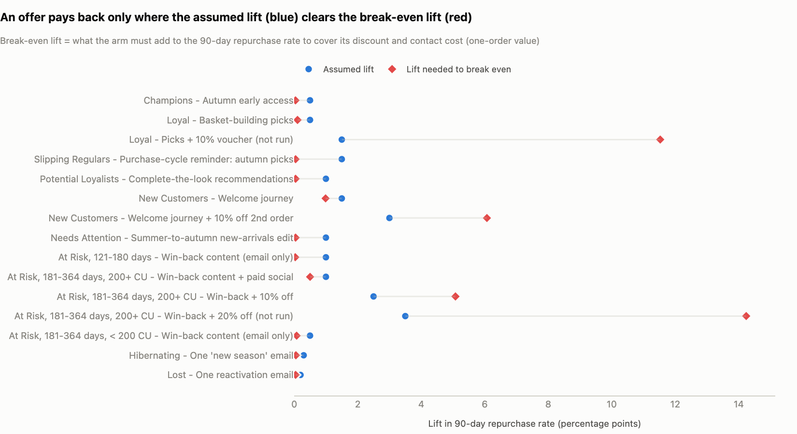
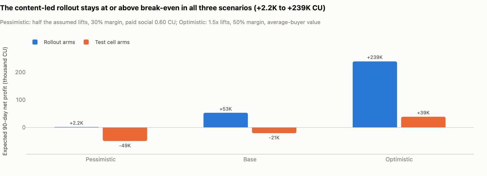

# Autumn 2020 CRM campaign plan

**Owner:** Marketing Analyst, CRM / Marketing Analytics · **Decision owner:** CRM Manager · **Data snapshot:** 2020-09-22 · **Launch:** 2020-09-28 · **Final read:** 2020-12-27 (day 90)
Audience rules: [segmentation spec](segmentation_spec.md) · holdout, KPIs and decision rules: [measurement plan](measurement_plan.md) · one-page memo: [readout](readout.md) · assumptions: [assumptions.md](assumptions.md) · interactive version: dashboard page "Campaign Plan & Measurement"

## 1. The plan in brief

The brief: the autumn budget is limited; keep the high-value customers, win back the ones drifting away, and decide what to do with customers who only buy online.

- **Content first, discounts only as tests.** Every audience worth contacting gets a content action (early access, purchase-cycle reminders, recommendations, a welcome journey, win-back picks); the rollout carries no discount. Two test cells measure whether 10% off pays: New Customers' second order, and At Risk customers 181-364 days quiet who spent 200+ CU. A 20% win-back offer and a Loyal voucher were considered and not run: they would need lifts of 14.2 and 11.5 percentage points to break even.
- **Keep Champions without discounting.** They are 14% of customers and 54% of 12-month revenue, and 83% buy again within 90 days with business-as-usual contact only. They get early access, not a coupon.
- **One cheap email for the lapsing tail.** Hibernating (284,069 customers, 6.6% of 12-month revenue, 14% buy again within 90 days on their own) and Lost each get a single email in week 4; at 0.01 CU a send, it pays back at a lift of about 0.05 points. **The Review List** (864 accounts) gets no offers or paid media until reviewed.
- **Online-only customers are reached online.** Channel decides the creative (section 5), not the budget; nothing in the data shows that a store push would raise their value.
- **Budget ask: 61.9K CU.** 13.5K CU for the rollout and 48.4K CU for the two test cells, 40.3K CU of which is coupon value.
- **Expected return, on planning assumptions:** the rollout reaches 445,473 customers and is expected to add 167K CU of revenue and 53K CU of net profit within 90 days (pessimistic +2.2K, optimistic +239K). The test cells are expected to lose 21K CU net (−49K to +39K across the scenarios): the price of finding out whether offers pay before anyone scales them.
- **Next to the do-nothing gap:** At Risk customers are 2.1M CU below their usual 90-day pace (2.1M-2.4M across scenarios) and Slipping Regulars 965K CU; the plan expects about 45K and 20K CU of incremental revenue from them (the 45K includes 18.8K from the At Risk 10% offer test cell; the content arms alone add about 26K). Much of each gap is natural slowdown, so the plan is judged on its measured lift, not on the gap.
- **Measured against the same 10% holdout in every audience.** The campaign-wide lift is detectable from 0.51 percentage points; the plan expects 0.84.

<!-- BEGIN:campaign_short -->
<!-- generated by `python run.py --steps docs` from the pipeline outputs; edit src/rfm/docgen.py, not this block -->

| Audience                        | Action                                          | When                                          | Channel                           | Category focus                                  | Discount   | Expected net (CU)   |
|:--------------------------------|:------------------------------------------------|:----------------------------------------------|:----------------------------------|:------------------------------------------------|:-----------|:--------------------|
| Champions                       | Autumn early access                             | 2020-09-29, two days before the public launch | Email + app message (subscribers) | their own usual categories                      | none       | +8.7K               |
| Loyal                           | Basket-building picks                           | Week 2 (from 2020-10-05)                      | Email + app message (subscribers) | Accessories (179), Jersey Basic (148)           | none       | +0.6K               |
| Slipping Regulars               | Purchase-cycle reminder: autumn picks           | Week 1 (2020-09-28), reminder day 10          | Email + app message (subscribers) | their own usual categories                      | none       | +7.9K               |
| Potential Loyalists             | Complete-the-look recommendations               | Week 1 (from 2020-09-28)                      | Email + app message (subscribers) | Sport dept. (126)                               | none       | +9.4K               |
| New Customers                   | Welcome journey                                 | Starts day 7 after the first order            | Email + paid social               | Swimwear (141), Sport dept. (124)               | none       | +3.4K               |
| New Customers                   | Welcome journey + 10% off 2nd order (test cell) | Same as the journey (parallel cell)           | Email + paid social               | Swimwear (141), Sport dept. (124)               | 10%        | -15K                |
| Needs Attention                 | Summer-to-autumn new-arrivals edit              | Week 1 (from 2020-09-28)                      | Email + app message (subscribers) | Swimwear (184)                                  | none       | +9.9K               |
| At Risk, 121-180 days           | Win-back content (email only)                   | Week 1 (from 2020-09-28)                      | Email (subscribers only)          | their own usual categories                      | none       | +3.6K               |
| At Risk, 181-364 days, 200+ CU  | Win-back content + paid social                  | Week 1 (from 2020-09-28)                      | Email + paid social               | Outdoor (165), Knitwear (155)                   | none       | +3.0K               |
| At Risk, 181-364 days, 200+ CU  | Win-back + 10% off (test cell)                  | Week 1, in parallel with the content cell     | Email + paid social               | Outdoor (165), Knitwear (155)                   | 10%        | -5.8K               |
| At Risk, 181-364 days, < 200 CU | Win-back content (email only)                   | Week 1 (from 2020-09-28)                      | Email (subscribers only)          | Knitwear (162), Menswear dept. (128)            | none       | +0.5K               |
| Hibernating                     | One 'new season' email                          | Week 4 (from 2020-10-19), with the Lost email | Email (subscribers only)          | Under-, Nightwear (128)                         | none       | +3.4K               |
| Lost                            | One reactivation email                          | Week 4 (from 2020-10-19)                      | Email (subscribers only)          | Baby/Children dept. (330), Menswear dept. (125) | none       | +3.3K               |
| Review List                     | no offers or paid media until reviewed          | -                                             | -                                 | -                                               | -          | -                   |

Expected net: 90-day net profit under base-case planning assumptions, not a measurement. Rollout total +53K CU (pessimistic +2.2K, optimistic +239K). Category focus: the categories the audience over-indexes on; the number in brackets compares the category's share of the audience's spend with its share for all customers (100 = average, 126 = 26% higher).

<!-- END:campaign_short -->

Expected net is after discount and contact costs (section 6).

## 2. Who gets what: one row per audience and arm

"Rollout" rows are the recommended actions. "Test cell" rows try a discount on part of an audience to learn whether it pays. "Not run" rows were considered and rejected; they stay in the table so the reasoning is visible. Assumed lifts are planning assumptions: percentage points of 90-day repurchase rate against the holdout, per assigned customer. Audience rules and counts: [segmentation spec, section 8](segmentation_spec.md#8-audiences-for-the-autumn-2020-campaign).

How the reachable customers of each audience are split (details in the [measurement plan](measurement_plan.md#3-randomisation)):

| Audience | Split of the reachable customers |
|---|---|
| New Customers | 45% welcome journey · 45% journey + 10% off the second order · 10% holdout |
| At Risk, 181-364 days, 200+ CU | 60% win-back content + paid social · 30% win-back + 10% off · 10% holdout |
| Every other audience | 90% the rollout arm · 10% holdout |

<!-- BEGIN:campaign_table -->
<!-- generated by `python run.py --steps docs` from the pipeline outputs; edit src/rfm/docgen.py, not this block -->

| Audience                        | Arm                                   | Role      | Goal                                                                                                                          | Action                                                                                                                                                                                                          | Timing                                                                               | Channel                                                                                        | Discount          | Assumed lift   | Primary KPI                                                        | Decision rule                                                                                                                     | Risk                                                                                |
|:--------------------------------|:--------------------------------------|:----------|:------------------------------------------------------------------------------------------------------------------------------|:----------------------------------------------------------------------------------------------------------------------------------------------------------------------------------------------------------------|:-------------------------------------------------------------------------------------|:-----------------------------------------------------------------------------------------------|:------------------|:---------------|:-------------------------------------------------------------------|:----------------------------------------------------------------------------------------------------------------------------------|:------------------------------------------------------------------------------------|
| Champions                       | Autumn early access                   | Rollout   | Keep the 14% of customers who bring in over half of 12-month revenue, without discounting                                     | Personal 48-hour early-access link to the autumn collection; free click-and-collect on the early-access order. No % discount.                                                                                   | 2020-09-29, two days before the public launch                                        | Email + personalised member-app message (subscribers only)                                     | none              | +0.5 pp        | 90-day repurchase rate vs holdout (revenue per customer secondary) | Keep as an always-on Champions benefit if the pooled campaign lift is positive; segment read is directional                       | 83% buy within 90 days anyway: a discount would mostly pay for orders we get anyway |
| Loyal                           | Basket-building picks                 | Rollout   | Frequent buyers with small baskets (AOV ~24 CU): add one more item per order                                                  | 'Complete your order' picks (accessories, basics multipacks) and a free-delivery threshold reminder. No discount.                                                                                               | Week 2 (from 2020-10-05)                                                             | Email + member-app message (subscribers only)                                                  | none              | +0.5 pp        | 90-day repurchase rate; AOV vs holdout (secondary)                 | Directional only (too small to read alone); judge AOV in the next quarterly review                                                | Low value per order: never fund paid media here                                     |
| Loyal                           | Picks + 10% voucher                   | Not run   | Considered: a voucher on the next order                                                                                       | Same picks + voucher worth 10% of the next order                                                                                                                                                                | -                                                                                    | Email                                                                                          | 10% off one order | +1.5 pp        | -                                                                  | Not run this season: break-even far above any plausible lift and the cell could not be read                                       | -                                                                                   |
| Slipping Regulars               | Purchase-cycle reminder: autumn picks | Rollout   | Early warning for valuable regulars: 5+ orders a year, now 61-120 days quiet - typically twice their usual gap between orders | 'New in for autumn' picks from the categories they bought most, sent in week 1; second touch on day 10 to those who have not bought since launch. No discount.                                                  | Week 1 (2020-09-28), reminder day 10                                                 | Email + member-app message (subscribers only)                                                  | none              | +1.5 pp        | 90-day repurchase rate vs holdout                                  | Make it an always-on trigger (fires when a regular passes 1.5x their usual gap) if lift > 0 at day 90                             | Contact pressure on a valuable group: respect the weekly cap                        |
| Potential Loyalists             | Complete-the-look recommendations     | Rollout   | Build the habit: the second and third order while the brand is top of mind                                                    | Personalised 'complete the look' email from the last order's category; customers who came back after 12+ months get a 'welcome back' version. No discount.                                                      | Week 1 (from 2020-09-28)                                                             | Email + member-app message (subscribers only)                                                  | none              | +1.0 pp        | 90-day repurchase rate vs holdout                                  | Directional only; keep if the pooled lift is positive                                                                             | Content-only lift may be small                                                      |
| New Customers                   | Welcome journey                       | Rollout   | Win the second order: the biggest drop-off on the order ladder                                                                | 3-email journey over 30 days (membership benefits, picks from the first order's category, delivery / returns / click-and-collect explained). No discount.                                                       | Starts day 7 after the first order; customers already in the segment enter in week 1 | Email (subscribers) + paid social for the two thirds not reachable by email                    | none              | +1.5 pp        | Second-order rate within 90 days vs holdout                        | Keep the journey always-on if its lift clears its break-even (paid social cost)                                                   | Paid-social match rates for new customers                                           |
| New Customers                   | Welcome journey + 10% off 2nd order   | Test cell | Learn whether a second-order coupon pays for itself                                                                           | Same journey + 10% off the second order, valid 30 days                                                                                                                                                          | Same as the journey (parallel cell)                                                  | Email (subscribers) + paid social                                                              | 10% off one order | +3.0 pp        | Second-order rate within 90 days vs journey-only cell and holdout  | Roll out the coupon only if its lift over the journey-only cell has a 95% lower bound above break-even; also track 12-month value | The 90-day view understates a second order's value (repeat customers keep buying)   |
| Needs Attention                 | Summer-to-autumn new-arrivals edit    | Rollout   | Re-engage summer buyers (61-120 days quiet) before they lapse                                                                 | New-arrivals edit that bridges from what they bought in summer (swimwear, underwear) to autumn basics; one-order customers get the second-order version of the welcome email. No discount.                      | Week 1 (from 2020-09-28); reminder in week 3 to those who have not bought            | Email + member-app message (subscribers only)                                                  | none              | +1.0 pp        | 90-day repurchase rate vs holdout                                  | Directional only; keep if the pooled lift is positive                                                                             | About a third come back on their own in autumn: keep it cheap                       |
| At Risk, 121-180 days           | Win-back content (email only)         | Rollout   | Recently lapsed valuable customers; 44% come back on their own, so no paid media                                              | Personalised 'we picked these for you' email from each customer's own top categories (this group last bought during the spring 2020 store closure and has no seasonal skew). No discount.                       | Week 1 (from 2020-09-28); reminder on day 7 to those who have not bought             | Email (subscribers only)                                                                       | none              | +1.0 pp        | 90-day repurchase rate and revenue per customer vs holdout         | Directional; feeds the pooled read                                                                                                | Low risk, near-zero cost                                                            |
| At Risk, 181-364 days, 200+ CU  | Win-back content + paid social        | Rollout   | Long-lapsed but high-spending customers: worth paying to reach the ~70% not on email                                          | Personalised win-back leading with outerwear and knitwear (they last bought in autumn / winter 2019-20 and over-index on both); paid-social retargeting to non-subscribers with the same creative. No discount. | Week 1 (from 2020-09-28); retargeting runs 3 weeks, stops for anyone who buys        | Email (subscribers) + paid social (non-subscribers, holdout uploaded as an exclusion audience) | none              | +1.0 pp        | 90-day repurchase rate vs holdout                                  | Keep paid social for this audience only if the measured lift clears its break-even                                                | Paid-social match rate and frequency fatigue                                        |
| At Risk, 181-364 days, 200+ CU  | Win-back + 10% off                    | Test cell | Learn whether a modest offer pays for itself where few customers come back alone                                              | Same win-back message + 10% off one order, valid 14 days                                                                                                                                                        | Week 1, in parallel with the content cell                                            | Email (subscribers) + paid social                                                              | 10% off one order | +2.5 pp        | 90-day repurchase rate vs content cell and holdout                 | Scale in the next wave only if the lift over the content cell has a 95% lower bound above break-even                              | Coupons also go to the ~1 in 4 who would have bought anyway                         |
| At Risk, 181-364 days, 200+ CU  | Win-back + 20% off                    | Not run   | Considered: a deep offer                                                                                                      | Same message + 20% off one order                                                                                                                                                                                | -                                                                                    | Email + paid social                                                                            | 20% off one order | +3.5 pp        | -                                                                  | Not run: under one-order value it needs a lift no win-back campaign delivers                                                      | -                                                                                   |
| At Risk, 181-364 days, < 200 CU | Win-back content (email only)         | Rollout   | Long-lapsed, lower-spend customers: stay present at near-zero cost                                                            | Knitwear-led win-back email (their strongest category), lighter version; no paid media, no discount                                                                                                             | Week 1 (from 2020-09-28)                                                             | Email (subscribers only)                                                                       | none              | +0.5 pp        | 90-day repurchase rate vs holdout (directional)                    | Directional only                                                                                                                  | Near-zero cost                                                                      |
| Hibernating                     | One 'new season' email                | Rollout   | Light buyers (1-2 orders, under 200 CU) quiet for 4-12 months: one cheap reminder before they lapse                           | Single 'new for autumn' email leading with underwear and nightwear (the category they over-index on); no paid media, no discount                                                                                | Week 4 (from 2020-10-19), with the Lost email                                        | Email (subscribers only)                                                                       | none              | +0.3 pp        | 90-day repurchase rate vs holdout (directional)                    | Directional only; feeds the pooled read. Non-responders stay on the business-as-usual newsletter                                  | Low expected lift; near-zero cost                                                   |
| Lost                            | One reactivation email                | Rollout   | Cheap last attempt, then move non-responders to a low-frequency list                                                          | Single 'see what's new' email in week 4 leading with kids' autumn and menswear (their over-indexed departments); suppressed from paid media                                                                     | Week 4 (from 2020-10-19)                                                             | Email (subscribers only)                                                                       | none              | +0.2 pp        | 90-day reactivation rate vs holdout (directional)                  | Non-responders after 90 days move to a quarterly newsletter cadence                                                               | Old addresses: watch spam complaints                                                |
| Review List                     | No autumn campaign                    | -         | -                                                                                                                             | No offers or paid media until CRM / retail ops have reviewed the accounts; service messages continue                                                                                                            | -                                                                                    | -                                                                                              | -                 | -              | -                                                                  | -                                                                                                                                 | -                                                                                   |

<!-- END:campaign_table -->

## 3. Category focus

A category is an audience's focus when its segment spends at least 20% more of its money on it than all customers do (affinity index of 120 or more, shown in brackets in the section 1 table) and the category is at least 5% of the segment's 12-month revenue (two years for Lost). Affinity also reflects *when* a segment last bought, so read it as "what to show them now", not as a fixed taste. Source: `sql/10_segment_mix.sql`; dashboard page "Segment Drill-down".

| Audience | Lead with | Why |
|---|---|---|
| Champions, Slipping Regulars | their own usual categories from past orders | they mirror the overall mix: no category stands out |
| Loyal | accessories and jersey basics as add-on items | both over-indexed, and they fit the basket-building goal |
| Potential Loyalists | sport, then "complete the look" from the last order's category | sport is over-indexed |
| New Customers | autumn basics in the departments of the first order | swimwear and sport were the summer entry points |
| Needs Attention | the bridge from summer swimwear to autumn basics | they last bought in summer |
| At Risk, 181-364 days (both audiences) | outerwear and knitwear first, then their own top categories | 200+ CU: outdoor 165, knitwear 155; < 200 CU: knitwear 162. Their last orders fell in autumn / winter 2019-20 |
| At Risk, 121-180 days | each customer's own top categories | they last bought during the spring 2020 store closure and under-index on knitwear (91) and outdoor (94) |
| Hibernating | underwear and nightwear | the only over-indexed group (128) |
| Lost | kids' autumn and menswear | the Baby/Children and Menswear departments are over-indexed |

## 4. Owners

| Area | Owner | Responsible for |
|---|---|---|
| Audiences, holdout split, reads | Marketing Analytics | launch-day re-score, hash split and balance check, assignment table, QA of counts against this plan, day-30 and day-90 reads |
| Email and member app | CRM | creative per arm and channel, sends and reminders, weekly contact cap, suppressions (holdout included), journeys and day-30 hand-offs, exit on purchase |
| Paid social | E-commerce | custom audiences for New Customers and At Risk 181-364 days 200+ CU, holdout exclusion on every ad set and in lookalike seeds, frequency caps, match-rate and spend report |
| Store-led creative and the Review List | Retail ops | creative for store-only and omnichannel customers (new in store, click-and-collect, in-store returns), in-store redemption of the test-cell offers, review of the 864 Review List accounts with CRM |
| Margin and budget | Finance | confirming the 40% contribution margin before launch, holding the 61.9K CU budget, booking coupon cost |
| Decisions | CRM Manager | sign-off on the plan, the budget and the segment thresholds; the day-90 decisions |

## 5. Contact, suppression and journey rules

These apply to every arm.

- **Re-score on launch day.** Audiences are rebuilt with the production SQL on 2020-09-28 from all orders up to and including 2020-09-27, not taken from the 2020-09-22 planning extract: 51% of customers changed segment in one quarter. The launch-day segment is the segment of record for the read, even if the customer moves later.
- **Suppress everywhere:** unsubscribed and bounced addresses; the Review List; the holdout (in email and app, and uploaded as an exclusion audience on every paid-social ad set, lookalike seed lists included); customers in another live test.
- **Contact cap:** at most one campaign email per customer per week, on top of the business-as-usual newsletter. Reminders go only to customers who have not bought since launch.
- **Exit on purchase:** a customer who buys leaves every reminder and retargeting audience within 24 hours.
- **Day-30 hand-offs:** New Customers without a second order move to the one-time-buyer version of the journey; Needs Attention and Potential Loyalists who have not bought move to win-back content; Lost non-responders move to a quarterly newsletter cadence after day 90.
- **App messages go to the same email subscribers.** App reach is not in the data, so the plan counts subscribers only. If the app can reach non-subscribers, the email-only audiences grow at no extra cost, and the holdout split must be redrawn on the larger population before launch.
- **Offers belong to the member account.** The two test-cell coupons are single-use and attached to the member account (shown in email, app and at checkout, valid online and in store), never a shareable code. This keeps the holdout clean and the coupon cost inside the test cells.
- **During the 90 days** the monthly segment refresh is for monitoring only. Nobody in the experiment gets segment-triggered campaign sends beyond the hand-offs above, and the always-on triggers started by this plan (the Slipping Regulars reminder, the welcome journey for customers who make a first order after launch) apply the same holdout rule.

**Channel treatment rules** (by `channel_12m`, the last 12 months):

| Channel | Treatment in every arm |
|---|---|
| Online only | online creative, delivery and free-returns message, member app; excluded from store events. Champions' early access leads with home delivery; click-and-collect is mentioned, not pushed |
| Store only | store-led creative (new in store, click-and-collect, in-store returns); no online-only vouchers, so test-cell coupons work at the till via the member app |
| Omnichannel | both; click-and-collect as the bridge |

Why channel decides the message and not the budget: 482,607 active customers (49%) had no identified store purchase in the last 12 months, 147,213 of them on email and 55,909 of them Champions, Loyal or Slipping Regulars. Online orders are about twice the size of store orders even for the same omnichannel customers (69.6 vs 33.4 CU), so online-only customers' higher spend at equal order counts (474 vs 357 CU a year at 5-9 orders) is mostly basket size, and it is before returns: an illustrative returns haircut of 25% online and 8% store narrows it to 355 vs 287 CU. Looking forward, they come back slightly less often (64% vs 69% within 90 days at 5-9 orders in the 2019 backtest; store only 65%). None of this shows that moving them into stores would make them more valuable, so the plan does not pay for a store push. A store-visit incentive can be tested later as its own holdout arm if Retail asks for it.

## 6. Economics

### 6.1 How each arm is valued

For each arm, over the 90 days from launch (code: `src/rfm/campaign.py`):

- **Extra buyers** = customers assigned to the arm × assumed lift. Lifts are planning assumptions per assigned customer (intention-to-treat): customers who never open the email or are not matched on paid social count too.
- **Extra revenue** = extra buyers × **one order** at the audience's AOV. This is deliberately conservative: a customer tipped into buying is valued as a marginal buyer placing one order. The optimistic scenario values them as the backtest's average 90-day buyer instead.
- **Contribution** = extra revenue × **40% contribution margin**: H&M's gross margin (52.6% in FY2019; 49.4% in the first half of 2020, per the six-month report) less about 10 points for fulfilment and returns on mostly online orders. To be confirmed with Finance.
- **Coupon cost** = every redeemed coupon × 10% of the AOV. Redemptions include customers who would have bought anyway: half of them are assumed to use the coupon.
- **Contact cost** = 0.01 CU per emailed customer per arm (all sends of the arm) and 0.30 CU per targeted non-subscriber on paid social (impressions on unmatched users included).
- **Net profit** = contribution − coupon cost − contact cost. **Break-even lift** = the lift at which net profit is zero.

### 6.2 Expected result per arm (base case)

<!-- BEGIN:campaign_economics -->
<!-- generated by `python run.py --steps docs` from the pipeline outputs; edit src/rfm/docgen.py, not this block -->

| Audience                        | Arm                                   | Role      | Contacted   | Buys anyway   | Assumed lift (pp)   | Break-even lift (pp)   | Incremental revenue (CU)   | Discount cost (CU)   | Contact cost (CU)   | Net profit (CU)   |
|:--------------------------------|:--------------------------------------|:----------|:------------|:--------------|:--------------------|:-----------------------|:---------------------------|:---------------------|:--------------------|:------------------|
| Champions                       | Autumn early access                   | Rollout   | 80,774      | 83.2%         | 0.5                 | 0.04                   | 23,691                     | 0                    | 808                 | 8,669             |
| Loyal                           | Basket-building picks                 | Rollout   | 14,613      | 68.3%         | 0.5                 | 0.10                   | 1,742                      | 0                    | 146                 | 551               |
| Loyal                           | Picks + 10% voucher                   | Not run   | 0           | 68.3%         | 1.5                 | 11.53                  | 0                          | 0                    | 0                   | 0                 |
| Slipping Regulars               | Purchase-cycle reminder: autumn picks | Rollout   | 24,602      | 68.0%         | 1.5                 | 0.05                   | 20,320                     | 0                    | 246                 | 7,882             |
| Potential Loyalists             | Complete-the-look recommendations     | Rollout   | 43,130      | 48.9%         | 1.0                 | 0.04                   | 24,478                     | 0                    | 431                 | 9,360             |
| New Customers                   | Welcome journey                       | Rollout   | 32,003      | 28.5%         | 1.5                 | 0.99                   | 24,769                     | 0                    | 6,536               | 3,371             |
| New Customers                   | Welcome journey + 10% off 2nd order   | Test cell | 32,003      | 28.5%         | 3.0                 | 6.07                   | 49,539                     | 28,487               | 6,536               | -15,208           |
| Needs Attention                 | Summer-to-autumn new-arrivals edit    | Rollout   | 45,741      | 34.8%         | 1.0                 | 0.04                   | 25,910                     | 0                    | 457                 | 9,907             |
| At Risk, 121-180 days           | Win-back content (email only)         | Rollout   | 13,092      | 43.9%         | 1.0                 | 0.04                   | 9,317                      | 0                    | 131                 | 3,596             |
| At Risk, 181-364 days, 200+ CU  | Win-back content + paid social        | Rollout   | 14,376      | 26.5%         | 1.0                 | 0.50                   | 15,048                     | 0                    | 3,017               | 3,002             |
| At Risk, 181-364 days, 200+ CU  | Win-back + 10% off                    | Test cell | 7,188       | 26.5%         | 2.5                 | 5.08                   | 18,810                     | 11,838               | 1,509               | -5,823            |
| At Risk, 181-364 days, 200+ CU  | Win-back + 20% off                    | Not run   | 0           | 26.5%         | 3.5                 | 14.24                  | 0                          | 0                    | 0                   | 0                 |
| At Risk, 181-364 days, < 200 CU | Win-back content (email only)         | Rollout   | 8,312       | 28.3%         | 0.5                 | 0.08                   | 1,335                      | 0                    | 83                  | 451               |
| Hibernating                     | One 'new season' email                | Rollout   | 73,319      | 13.7%         | 0.3                 | 0.05                   | 10,243                     | 0                    | 733                 | 3,364             |
| Lost                            | One reactivation email                | Rollout   | 95,511      | 7.1%          | 0.2                 | 0.05                   | 10,578                     | 0                    | 955                 | 3,276             |

<!-- END:campaign_economics -->

### 6.3 Why discounts rarely pay back here

Take the New Customers coupon cell, per 100 customers assigned:

- 28.5 of them would place another order within 90 days anyway (2019 backtest). If half use the coupon, about 14 coupons × 5.16 CU (10% of a 51.6 CU order) ≈ 74 CU goes on orders we would have had.
- Reaching the 100 costs about 20 CU (two thirds by paid social at 0.30 CU, one third by email).
- Each extra buyer brings one order: 51.6 CU × 40% = 20.6 CU of contribution, less the 5.16 CU coupon = 15.5 CU.
- Covering 94 CU therefore takes about 6 extra buyers per 100: a break-even lift of 6.07 points, twice the 3.0 we assume.

As a rule of thumb, with a 40% margin, one-order value and half of the would-be buyers redeeming, a 10% coupon needs a lift of about one sixth of the audience's natural repurchase rate just to cover the subsidy, before contact costs; a 20% coupon needs about half. That is why:

- **Where most buy anyway, a coupon cannot pay.** The Loyal voucher would need 11.5 points (68% buy anyway); for Champions (83%) any coupon would need a double-digit lift.
- **Deeper is worse.** The 20% win-back offer would need 14.2 points even where only 26% come back on their own.
- **The tests sit where an offer has its best chance:** the second order, which is the biggest drop-off on the order ladder for new customers (28.5% buy again within 90 days on their own), and long-lapsed high spenders, of whom only 26.5% come back on their own and whose orders are worth 104.7 CU. Even there the assumed lifts (3.0 and 2.5 points) are about half of break-even (6.07 and 5.08), so the plan expects both cells to lose money and tests them rather than assuming the answer.
- **Content is nearly free.** At 0.01 CU per emailed customer most content arms break even at a lift of 0.1 points or less. Paid social raises the bar (0.99 points for the New Customers journey, 0.50 for At Risk 181-364 days 200+ CU), so it is used only for those two audiences, where most customers are not on email (67% and 69%) and the second order or a 104.7 CU basket is at stake.

### 6.4 Scenarios

Every arm is recomputed under three sets of assumptions (from `config.yaml`):

| Assumption | Pessimistic | Base | Optimistic |
|---|---|---|---|
| Assumed lifts | half | as in the plan | 1.5 × |
| Contribution margin | 30% | 40% | 50% |
| Value of an extra buyer | one order at the audience AOV | one order at the audience AOV | backtest average 90-day revenue per buyer |
| Paid social per targeted non-subscriber | 0.60 CU | 0.30 CU | 0.30 CU |
| Coupon use by customers who would buy anyway | 60% | 50% | 40% |
| Email, per emailed customer and arm | 0.01 CU | 0.01 CU | 0.01 CU |

<!-- BEGIN:scenarios -->
<!-- generated by `python run.py --steps docs` from the pipeline outputs; edit src/rfm/docgen.py, not this block -->

| Scenario    | Arms      | Contacted   | Cost (CU)   | Incremental revenue (CU)   | Net profit (CU)   |
|:------------|:----------|:------------|:------------|:---------------------------|:------------------|
| Pessimistic | Rollout   | 445,473     | 22,947      | 83,716                     | 2,167             |
| Pessimistic | Test cell | 39,191      | 59,568      | 34,174                     | -49,315           |
| Base        | Rollout   | 445,473     | 13,544      | 167,432                    | 53,428            |
| Base        | Test cell | 39,191      | 48,370      | 68,348                     | -21,031           |
| Optimistic  | Rollout   | 445,473     | 13,544      | 505,154                    | 239,033           |
| Optimistic  | Test cell | 39,191      | 45,089      | 168,299                    | 39,060            |

<!-- END:scenarios -->

The content rollout stays at or above break-even in all three scenarios. The test cells lose money except in the optimistic case, where extra buyers are valued at the average buyer's 90-day spend.

### 6.5 Next to the do-nothing gap

<!-- BEGIN:revenue_at_risk -->
<!-- generated by `python run.py --steps docs` from the pipeline outputs; edit src/rfm/docgen.py, not this block -->

| Segment             | Customers   | Usual 90-day pace (CU)   | Expected, do nothing (CU)   | Gap vs pace (CU)   | Gap range (CU)         | Buy again in 90 days   | Expected non-buyers   | Plan's incremental revenue (CU)   |
|:--------------------|:------------|:-------------------------|:----------------------------|:-------------------|:-----------------------|:-----------------------|:----------------------|:----------------------------------|
| Champions           | 190,320     | 33,012,083               | 29,568,076                  | 3,444,007          | 3,444,007 to 4,666,940 | 82.6%                  | 33,208                | 23,691                            |
| Loyal               | 33,612      | 1,230,498                | 1,651,398                   | -420,899           | -420,899 to -375,998   | 68.3%                  | 10,670                | 1,742                             |
| Slipping Regulars   | 61,655      | 6,317,226                | 5,352,057                   | 965,169            | 965,169 to 1,526,271   | 67.1%                  | 20,310                | 20,320                            |
| Potential Loyalists | 124,517     | 4,742,893                | 5,401,602                   | -658,709           | -658,709 to -181,544   | 48.1%                  | 64,586                | 24,478                            |
| New Customers       | 71,117      | 1,207,149                | 1,772,459                   | -565,310           | -565,310 to -243,654   | 28.4%                  | 50,936                | 74,308                            |
| Needs Attention     | 137,675     | 4,356,753                | 4,115,999                   | 240,755            | 240,755 to 534,276     | 33.2%                  | 91,982                | 25,910                            |
| At Risk             | 89,848      | 5,774,253                | 3,668,360                   | 2,105,894          | 2,105,894 to 2,408,597 | 34.7%                  | 58,643                | 44,510                            |
| Hibernating         | 284,069     | 4,013,479                | 3,151,966                   | 861,514            | 413,492 to 938,763     | 14.0%                  | 244,267               | 10,243                            |
| Lost                | 368,604     | 0                        | 1,805,322                   | -                  | -                      | 6.3%                   | 345,322               | 10,578                            |
| Review List         | 864         | 315,132                  | 323,895                     | -8,763             | -15,904 to -6,566      | 66.1%                  | 293                   | 0                                 |

<!-- END:revenue_at_risk -->

- **Usual pace** = 12-month revenue × 90/365. **Expected, do nothing** = what look-alike customers spent in the 90 days after 2019-09-22 (same season one year earlier), re-weighted to today's mix of recency × frequency × spend × 12-month channel. The range adds the 2020-06-24 quarter and, per customer type, the worse of the two.
- **The gap is not money a campaign can recover.** Customers are put in a segment because of their last 12 months, so part of every gap is natural slowdown and regression to the mean. Champions show a 3.4M CU gap that is not churn: in the backtest, Champions spending 400+ CU realised 86% of their pace and those spending 200-399 CU 105%.
- **The last column is what this plan expects to add:** about 45K CU from At Risk against a 2.1M CU gap (18.8K of it from the 10% offer test cell, which is expected to lose money; the content arms alone add about 26K), and 20K CU from Slipping Regulars against 965K CU. Hold the plan to the measured lift, not to the gap.
- **Today's At Risk group is unlike either backtest:** 60% of them last bought during the March-May 2020 lockdown, which is the main reason for the pessimistic scenario. The statistical interval around the base case covers sampling noise only; the scenario range is the uncertainty to quote.

## 7. Budget ask

<!-- BEGIN:budget -->
<!-- generated by `python run.py --steps docs` from the pipeline outputs; edit src/rfm/docgen.py, not this block -->

| Line                                                              | CU      | How it is calculated                                                                   |
|:------------------------------------------------------------------|:--------|:---------------------------------------------------------------------------------------|
| Email sends (all rollout arms)                                    | 4,141   | 414,129 contacts x 0.01 CU                                                             |
| Paid social (New Customers journey, At Risk 181-364 days 200+ CU) | 9,403   | 31,344 non-subscribers x 0.3 CU                                                        |
| Test cells: discounts                                             | 40,325  | coupon value on all redeemed orders in the two test cells                              |
| Test cells: contacts                                              | 8,045   | email + paid social for the test cells                                                 |
| Total budget ask                                                  | 61,915  | cash cost of the autumn wave                                                           |
| Memo: profit given up by holding out 10%                          | 6,478   | holdout x assumed lift x one-order value x margin (the price of being able to measure) |
| Memo: expected net of test cells                                  | -21,031 | negative = what we expect to pay to learn whether the offers work                      |

<!-- END:budget -->

The cash ask is 61.9K CU. The two memo lines are not cash: the profit given up by holding out 10% (6.5K CU, the price of being able to measure) and the expected net of the test cells (−21.0K CU, the price of learning whether offers pay).

**If the budget is cut**, drop in this order:

1. **The At Risk 10% test cell.** Its customers join the content + paid social arm; this saves the coupon cost (11.8K CU in the base case), and the offer question waits a season.
2. **Paid social for New Customers**, in both New Customers cells so the coupon test stays a clean comparison; email still reaches a third of them. The coupon test then runs on email subscribers only and, re-checked with the same power formula, stays within two thirds of its (lower) break-even.
3. **The New Customers coupon cell**, last, because the second order is where a discount has the best chance of paying.
4. Only after that, **paid social for At Risk 181-364 days, 200+ CU**.

The email-only content arms are never cut: together they cost about 4.0K CU.

## 8. Timeline

| Date | Day | What | Owner |
|---|---|---|---|
| 2020-09-23 to 09-25 | | Build audiences with the production SQL; dry-run the hash split; QA counts against this plan; creative, coupon and paid-social set-up; Finance confirms the margin; sign-off | Marketing Analytics, CRM, E-commerce, Finance |
| 2020-09-28 (Mon) | 0 | **Launch.** Re-score audiences; final split and balance check; holdout exclusions uploaded. Week-1 sends: At Risk (all three audiences, both cells), Slipping Regulars, Potential Loyalists, Needs Attention. New Customers journey starts (customers already in the segment enter now) with paid social for the length of the journey; At Risk paid-social retargeting starts | all |
| 2020-09-29 (Tue) | 1 | Champions early-access link, 48 hours before the public launch on 2020-10-01 | CRM |
| 2020-10-01 (Thu) | 3 | Monthly segment refresh (monitoring only, also on 11-01 and 12-01) | Marketing Analytics |
| 2020-10-05 (Mon) | 7 | Week 2: Loyal basket-building picks; At Risk reminder to those who have not bought | CRM |
| 2020-10-08 (Thu) | 10 | Slipping Regulars second touch to those who have not bought | CRM |
| 2020-10-12 (Mon) | 14 | Week 3: Needs Attention reminder | CRM |
| 2020-10-18 (Sun) | 20 | At Risk paid-social retargeting ends (3 weeks) | E-commerce |
| 2020-10-19 (Mon) | 21 | Week 4: Hibernating 'new season' email and Lost reactivation email | CRM |
| 2020-10-28 (Wed) | 30 | Interim read: delivery and guardrails only, no lift decisions. Day-30 hand-offs start | Marketing Analytics, CRM |
| 2020-11-27 (Fri) | 60 | Black Friday: business-as-usual sends to everyone, holdout included (Christmas sends in December likewise) | CRM |
| 2020-12-27 (Sun) | 90 | **Final read** on orders up to 2020-12-26: which journeys stay always-on, and whether either offer scales in the next wave | Marketing Analytics → CRM Manager |
| 2021-09-28 | 365 | 12-month follow-up of the New Customers coupon cell against the journey-only cell | Marketing Analytics |

## 9. Risks

| Risk | What we do about it | Owner |
|---|---|---|
| Lifts are lower than assumed (they are planning assumptions) | the rollout is content-led and stays at or above break-even even at half the lifts; the holdout replaces the assumptions with measurements | Marketing Analytics |
| Today's At Risk customers behave unlike any backtest (60% last bought in the spring 2020 lockdown) | pessimistic scenario; re-score at launch; measured, not assumed | Marketing Analytics |
| A second wave closes stores again | the holdout keeps the comparison valid; store-led creative switches to click-and-collect and online; expected spend of store-heavy customers would fall below every scenario | CRM, Retail ops |
| Contact pressure on valuable customers (Champions, Slipping Regulars) | weekly cap, exit on purchase, day-30 guardrails with a pause rule | CRM |
| Coupons leak (codes shared beyond the cells) | single-use offers bound to the member account; leakage check at day 30 | CRM, E-commerce |
| Holdout customers reached through paid social | exclusion upload on every ad set, holdout removed from lookalike seeds, contamination check from platform logs | E-commerce |
| Low paid-social match rates for New Customers | the cost per targeted non-subscriber already includes wasted impressions; match rate reported at day 30; New Customers paid social is step 2 of the cut order | E-commerce |
| The 40% margin is wrong | Finance confirms before launch; the scenarios run at 30% and 50% | Finance |
| Black Friday and Christmas inside the window; orders pulled forward from January | both groups get the same business-as-usual sends; days 91-180 are checked to see whether the campaign group's lead over the holdout shrinks | Marketing Analytics |
| Review List accounts that turn out to be ordinary customers | no offers until reviewed; service messages continue; retail ops and CRM review the 864 accounts | Retail ops, CRM |
| Audiences drift between planning (2020-09-22) and launch | launch-day re-score; counts checked against this plan before the first send | Marketing Analytics |

## 10. Out of scope

- A store-visit push for online-only customers: nothing shows it would raise their value; it can be tested later as its own holdout arm.
- Discounts outside the two test cells, including the 20% win-back offer and the Loyal voucher.
- Discounts or paid media for Hibernating and Lost (one email each), and any offer to the Review List before it is reviewed.
- Non-subscribers in email-only audiences: no free channel to them is known in this data (member-app reach is not in the data).
- Measuring the business-as-usual newsletter, Black Friday or Christmas: the holdout receives them too.
- Returns-adjusted economics: the data has no returns; the 40% margin allows for them on average.
- Product recommendations per customer, predicted lifetime-value or churn models, price elasticity, and store-level planning (there is no store id).
