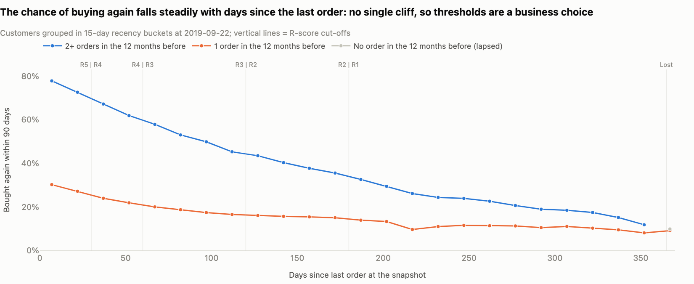
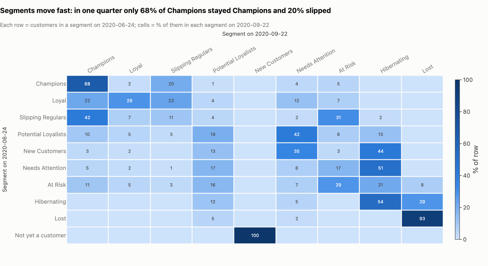

# Segmentation spec: lifecycle segments, value tier and channel

**Owner:** Marketing Analyst, CRM / Marketing Analytics (maintains the SQL and this spec, runs the monthly refresh) · **Changes signed off by:** CRM Manager
**Used by:** CRM (email and member-app audiences), e-commerce (paid-social uploads), retail ops (store-led creative, Review List)
**Version:** 1.0, built on the 2020-09-22 snapshot for the autumn 2020 campaign · **Production SQL:** [`sql/05_customer_rfm.sql`](../sql/05_customer_rfm.sql) · **Parameters:** [`config.yaml`](../config.yaml)

## 1. Purpose

This is the rule book the CRM team builds audiences from. Every customer with at least one order gets three labels:

| Label | Answers | Field |
|---|---|---|
| Lifecycle segment (10 groups) | what do we do with this customer? | `segment` |
| Value tier | how much effort is this customer worth? | `value_tier` |
| 12-month channel profile | which message fits? | `channel_12m` |

All three are plain SQL rules on the order history, so any audience builder can reproduce them. This page defines the inputs and rules, lists the counts a correct rebuild must match, names the audiences used this autumn, and sets how the segments are refreshed, monitored and changed. Segments describe the last 12 months; they are not a prediction model. Applied at two past dates, the same rules ranked what customers did in the following 90 days in the expected order, Champions highest and Lost lowest (dashboard page "Segments Overview"). Metric definitions in full: [02_metric_definitions.md](02_metric_definitions.md).

## 2. Inputs

All fields are built from the transaction, customer and article files of the H&M Personalized Fashion Recommendations dataset (Kaggle, 2022): 31,788,324 item rows from 2018-09-20 to 2020-09-22, with 1,362,281 customers who placed an order (1,371,980 rows in `customers.csv`). Four definitions sit underneath every field:

- **Order** = everything one customer bought on one day in one channel. There is no order id in the data.
- **Units:** there is no quantity column; identical rows are extra units of the same item and are kept in a `units` column.
- **Money** is in **CU** = price × 590. Every price lands on a retail price point (9.99, 19.99, 14.99 ...); the currency is not disclosed. Revenue is **gross demand**: the data has no returns.
- **Channel:** 1 = store, 2 = online, confirmed by the COVID closure (no store sales from 2020-03-20 to 2020-05-05; stores reopened 2020-05-06).

| Field | In plain words | Rule | Built in |
|---|---|---|---|
| `recency_days` | days since the last order | snapshot date − last order date; 0 = bought on the snapshot day | `sql/05` from `fct_orders` (`sql/03`) |
| `frequency_12m` | orders in the last 12 months | orders dated in the 365 days ending on the snapshot date, `snapshot_date - order_date < 365` (2019-09-24 to 2020-09-22 for this snapshot; 2020 has a 29 February) | `sql/05` |
| `monetary_12m_cu` | spend in the last 12 months | revenue of those orders in CU, before returns | `sql/05`; line revenue from `fct_sales_lines` (`sql/02`) |
| `tenure_days` | how long we have known the customer | snapshot date − first order date seen in the data (history starts 2018-09-20) | `sql/05` |
| `orders_to_date` | all orders up to the snapshot | count over the whole history in the data | `sql/05`; context only, not used by the rules |
| `is_excluded` | Review List flag | ≥ 20 units of one article in one order, OR ≥ 100 units in one order, OR purchases on ≥ 150 different days in the two-year history | `sql/04` (`dim_customers`) |
| `r_score`, `f_score`, `m_score` | 0-5 scores | fixed thresholds, section 3 | `sql/05` |
| `value_tier` | VIP / High / Mid / Low / None | 12-month spend, section 6 | `sql/05` |
| `channel_12m` | Online only / Store only / Omnichannel / No 12m orders | store vs online orders in the same 12 months, section 7 | `sql/05` |
| `is_newsletter_subscriber` | reachable by email | fashion-news frequency "Regularly" or "Monthly" in `customers.csv` | `sql/04` |

**Output:** `data/marts/customer_rfm.parquet`, one row per snapshot × customer with at least one order on or before the snapshot date. `snapshot_name = 'current'` (2020-09-22) is the targeting snapshot; the two backtest snapshots (2019-09-22 and 2020-06-24) use identical rules. The table also carries `channel_profile_2y` (two-year channel) for context only: it includes orders after the backtest dates, so it must never be used with backtest outcomes.

**How to rebuild:** `python run.py --steps marts` (or `python scripts/run_sql.py sql/05_customer_rfm.sql` after `sql/02`-`sql/04`). The pipeline passes every threshold from `config.yaml`; the SQL repeats them as defaults so the file also runs on its own. The dashboard's Python copy of the rules (`src/rfm/segments.py`, used by the threshold sliders) is checked against the SQL for all three snapshots by `tests/test_segments_parity.py`.

## 3. Scores and thresholds

| Score | 5 | 4 | 3 | 2 | 1 | 0 |
|---|---|---|---|---|---|---|
| **R**: days since last order | 0-30 | 31-60 | 61-120 | 121-180 | 181-364 | 365+ (Lost, not scored) |
| **F**: orders in 12 months | 10+ | 5-9 | 3-4 | 2 | 1 | none |
| **M**: spend in 12 months (CU) | 400+ | 200-399 | 100-199 | 50-99 | under 50 | none |

Share of the 993,492 customers active in the 12 months to 2020-09-22 in each score (a sanity check for any rebuild on this snapshot):

| | 5 | 4 | 3 | 2 | 1 |
|---|---|---|---|---|---|
| R | 25% | 15% | 22% | 12% | 25% |
| F | 11% | 20% | 18% | 16% | 34% |
| M | 17% | 18% | 20% | 19% | 26% |

```sql
-- sql/05_customer_rfm.sql, step 4 (values from config.yaml)
CASE WHEN recency_days <= getvariable('r5_max_days')  THEN 5
     WHEN recency_days <= getvariable('r4_max_days')  THEN 4
     WHEN recency_days <= getvariable('r3_max_days')  THEN 3
     WHEN recency_days <= getvariable('r2_max_days')  THEN 2
     WHEN recency_days <  getvariable('lookback_days') THEN 1
     ELSE 0 END                                                  AS r_score,
CASE WHEN frequency_12m >= getvariable('f5_min_orders') THEN 5
     WHEN frequency_12m >= getvariable('f4_min_orders') THEN 4
     WHEN frequency_12m >= getvariable('f3_min_orders') THEN 3
     WHEN frequency_12m >= getvariable('f2_min_orders') THEN 2
     WHEN frequency_12m >= 1                            THEN 1
     ELSE 0 END                                                  AS f_score,
CASE WHEN frequency_12m = 0                             THEN 0
     WHEN monetary_12m_cu >= getvariable('m5_min_cu')   THEN 5
     WHEN monetary_12m_cu >= getvariable('m4_min_cu')   THEN 4
     WHEN monetary_12m_cu >= getvariable('m3_min_cu')   THEN 3
     WHEN monetary_12m_cu >= getvariable('m2_min_cu')   THEN 2
     ELSE 1 END                                                  AS m_score
```

Variables: `r5/r4/r3/r2_max_days` = 30 / 60 / 120 / 180, `lookback_days` = 365, `f5/f4/f3/f2_min_orders` = 10 / 5 / 3 / 2, `m5/m4/m3/m2_min_cu` = 400 / 200 / 100 / 50, `new_customer_days` = 90, `vip_min_cu` = 1000.

**Why these cut-offs.**

- **Recency and Monetary are the active-customer quintiles, rounded to numbers people can say out loud.** Recency quintile edges are 23 / 60 / 112 / 215 days; we use 30 / 60 / 120 / 180 (a monthly cycle, two months, a season missed, two seasons), and 365+ days is Lost, the usual 12-month-active definition. Monetary quintile edges are 40 / 85 / 166 / 352 CU; we use 50 / 100 / 200 / 400.
- **Frequency is set by hand.** 34% of active customers have exactly one order and 16% have two, so the quintile edges tie (1 / 2 / 3 / 7 orders) and would split identical customers at random.
- **The numbers are fixed, not refitted.** Quintile edges move every month with the customer base. Fixed thresholds mean "R5" or "Champions" stands for the same customers in October as in September, so audiences, journeys and month-on-month comparisons stay meaningful.
- **What the recency curve shows, and what it does not.** In the 2019 backtest the share of repeat buyers who came back within 90 days falls smoothly, from about 78% for those who had just bought to about 12% after a year without an order, with no cliff. That supports recency as the main axis of the segmentation; it does not prove where the lines must be. At 120 days repeat buyers still come back at about 43%, which is why the 61-120-day groups get a cheap nudge rather than a win-back offer.



## 4. Segment rules (first matching rule wins)

```sql
-- sql/05_customer_rfm.sql, step 5
CASE
    WHEN d.is_excluded                                         THEN 'Review List'
    WHEN s.recency_days >= getvariable('lookback_days')        THEN 'Lost'
    WHEN s.tenure_days  <  getvariable('new_customer_days')    THEN 'New Customers'
    WHEN s.r_score >= 4 AND s.f_score >= 4 AND s.m_score >= 4  THEN 'Champions'
    WHEN s.r_score >= 4 AND s.f_score >= 4                     THEN 'Loyal'
    WHEN s.r_score  = 3 AND s.f_score >= 4                     THEN 'Slipping Regulars'
    WHEN s.r_score >= 4                                        THEN 'Potential Loyalists'
    WHEN s.r_score  = 3                                        THEN 'Needs Attention'
    WHEN s.f_score >= 3 OR s.m_score >= 4                      THEN 'At Risk'
    ELSE 'Hibernating'
END                                                            AS segment
```

The order of the lines is part of the definition:

1. **Review List** overrides everything, so a bulk or near-daily buyer never lands in a paid audience. The flag describes a buying pattern; it does not say what the account is. These 864 accounts stay in every total and get no offers or paid media until CRM and retail ops have reviewed them; the rule moves 0.5% of revenue.
2. **Lost** = no order in 365 days; their F and M scores are 0 and their value tier is None.
3. **New Customers** comes before Champions: in their first 90 days customers get the second-order journey even if they already spend like Champions (30 VIPs and 613 High-tier customers are New Customers today). The value tier keeps them visible.
4. **Champions** vs **Loyal**: both bought in the last 60 days with 5+ orders; Loyal are the ones under 200 CU (frequent, small baskets).
5. **Slipping Regulars** are checked before Potential Loyalists and Needs Attention, so frequent buyers who have gone quiet for 61-120 days are not mixed with occasional buyers.
6. By the **At Risk** line only customers 121-364 days quiet are left (R = 1 or 2); At Risk are those who used to buy often (3+ orders) or a lot (200+ CU). **Hibernating** is the rest: 1-2 orders and under 200 CU.

<!-- BEGIN:segment_summary -->
| Segment             | Rule (scores)                                                                                 | In plain words                                                                             | Customers     | % customers   | % 12m revenue   | AOV (CU)   | Orders / 12m   | Email reach   |
|:--------------------|:----------------------------------------------------------------------------------------------|:-------------------------------------------------------------------------------------------|:--------------|:--------------|:----------------|:-----------|:---------------|:--------------|
| Champions           | R >= 4 and F >= 4 and M >= 4                                                                  | Bought in the last 60 days, 5+ orders and 200+ CU in the last 12 months                    | 190,320       | 14.0%         | 54.1%           | 58.7       | 12.0           | 47%           |
| Loyal               | R >= 4 and F >= 4 (remaining)                                                                 | Bought in the last 60 days, 5+ orders in 12 months, under 200 CU (frequent, small baskets) | 33,612        | 2.5%          | 2.0%            | 23.8       | 6.2            | 48%           |
| Slipping Regulars   | R = 3 and F >= 4                                                                              | 5+ orders in 12 months, but no order in the last 61-120 days                               | 61,655        | 4.5%          | 10.4%           | 55.1       | 7.5            | 44%           |
| Potential Loyalists | R >= 4 (remaining)                                                                            | Bought in the last 60 days, 1-4 orders in 12 months (not new)                              | 124,517       | 9.1%          | 7.8%            | 56.8       | 2.7            | 38%           |
| New Customers       | tenure < 90 days                                                                              | First order within the last 90 days                                                        | 71,117        | 5.2%          | 2.0%            | 51.6       | 1.3            | 33%           |
| Needs Attention     | R = 3 (remaining)                                                                             | Last order 61-120 days ago, 1-4 orders in 12 months                                        | 137,675       | 10.1%         | 7.1%            | 56.6       | 2.3            | 37%           |
| At Risk             | R <= 2 and (F >= 3 or M >= 4)                                                                 | Last order 121-364 days ago but used to buy often (3+ orders) or a lot (200+ CU)           | 89,848        | 6.6%          | 9.5%            | 69.5       | 3.7            | 35%           |
| Hibernating         | R <= 2 (remaining)                                                                            | Last order 121-364 days ago, 1-2 orders and under 200 CU                                   | 284,069       | 20.9%         | 6.6%            | 46.6       | 1.2            | 29%           |
| Lost                | recency >= 365 days                                                                           | No order in the last 365 days                                                              | 368,604       | 27.1%         | 0.0%            | 55.4       | 0.0            | 29%           |
| Review List         | >= 20 units of one article in an order, >= 100 units in an order, or purchases on >= 150 days | Bulk or near-daily buying pattern: no offers or paid media until reviewed                  | 864           | 0.1%          | 0.5%            | 64.9       | 22.8           | 37%           |
| **Total**           |                                                                                               | all customers with an order 2018-09-20 to 2020-09-22                                       | **1,362,281** | **100.0%**    | **100.0%**      |            |                |               |

<sub>Generated from the pipeline outputs by `python run.py --steps docs`; do not edit by hand.</sub>
<!-- END:segment_summary -->

AOV = 12-month revenue / 12-month orders (two-year AOV for Lost). Email reach = share of the segment on the newsletter.

## 5. Expected counts (reconciliation check)

A rebuild on the 2020-09-22 snapshot must match these numbers exactly. The totals tie back to the source files: 1,362,281 customers with an order plus 9,699 registered customers with no order in the window equals the 1,371,980 rows of `customers.csv`, and 12-month and two-year revenue match the order table to the cent (`sql/13_reconciliation_checks.sql`, 19 of 19 checks pass).

<!-- BEGIN:segment_counts -->
| Segment                                         | Customers     | 12-month revenue (CU)   | Two-year revenue (CU)   |
|:------------------------------------------------|:--------------|:------------------------|:------------------------|
| Champions                                       | 190,320       | 133,882,338             | 252,123,399             |
| Loyal                                           | 33,612        | 4,990,355               | 11,012,863              |
| Slipping Regulars                               | 61,655        | 25,619,860              | 51,038,065              |
| Potential Loyalists                             | 124,517       | 19,235,065              | 40,676,007              |
| New Customers                                   | 71,117        | 4,895,660               | 4,895,660               |
| Needs Attention                                 | 137,675       | 17,669,055              | 36,532,607              |
| At Risk                                         | 89,848        | 23,417,805              | 48,390,667              |
| Hibernating                                     | 284,069       | 16,276,889              | 37,425,234              |
| Lost                                            | 368,604       | 0                       | 37,088,648              |
| Review List                                     | 864           | 1,278,036               | 2,757,975               |
| **Total with an order**                         | **1,362,281** | **247,265,063**         | **521,941,125**         |
| Registered, no order in the window (not scored) | 9,699         | 0                       | 0                       |
| **All customers in customers.csv**              | **1,371,980** |                         |                         |

<sub>Generated from the pipeline outputs by `python run.py --steps docs`; do not edit by hand.</sub>
<!-- END:segment_counts -->

If a rebuild does not match, check the two usual suspects first: the 12-month window (`snapshot_date - order_date < 365`, so it starts on 2019-09-24; "the same date last year" or `<= 365` adds a day or two because of the leap day), and the order definition (customer × day × channel, not transaction rows or receipts).

## 6. Value tier (second axis)

```sql
CASE WHEN s.frequency_12m = 0                                  THEN 'None'
     WHEN s.monetary_12m_cu >= getvariable('vip_min_cu')       THEN 'VIP'
     WHEN s.monetary_12m_cu >= getvariable('m5_min_cu')        THEN 'High'
     WHEN s.monetary_12m_cu >= getvariable('m4_min_cu')        THEN 'Mid'
     ELSE 'Low' END                                            AS value_tier
```

VIP = 1,000+ CU in 12 months, High = 400-999, Mid = 200-399, Low = under 200, None = no 12-month order. High and Mid start at the M5 and M4 thresholds, so the tier lines up with the M score.

The lifecycle segment says what to do; the tier says how much effort a customer is worth. Within At Risk it decides paid reach (paid social and the offer test only for customers 181-364 days quiet with 200+ CU, i.e. Mid tier and above), and everywhere it keeps high spenders visible wherever their lifecycle puts them: the 41,118 VIPs (3% of customers) bring in 27.9% of 12-month revenue; 35,366 of them are Champions, but 3,546 are Slipping Regulars and 1,230 At Risk.

<!-- BEGIN:value_grid -->
| Segment                   | VIP (1,000+ CU)   | High (400-999)   | Mid (200-399)   | Low (< 200)   | None (no 12m spend)   |
|:--------------------------|:------------------|:-----------------|:----------------|:--------------|:----------------------|
| Champions                 | 35,366            | 84,627           | 70,327          | 0             | 0                     |
| Loyal                     | 0                 | 0                | 0               | 33,612        | 0                     |
| Slipping Regulars         | 3,546             | 19,017           | 23,980          | 15,112        | 0                     |
| Potential Loyalists       | 380               | 6,775            | 22,006          | 95,356        | 0                     |
| New Customers             | 30                | 613              | 2,952           | 67,522        | 0                     |
| Needs Attention           | 265               | 5,341            | 18,853          | 113,216       | 0                     |
| At Risk                   | 1,230             | 12,895           | 35,173          | 40,550        | 0                     |
| Hibernating               | 0                 | 0                | 0               | 284,069       | 0                     |
| Lost                      | 0                 | 0                | 0               | 0             | 368,604               |
| Review List               | 301               | 163              | 88              | 127           | 185                   |
| **% of 12-month revenue** | **27.9%**         | **31.9%**        | **19.9%**       | **20.3%**     | **0.0%**              |

<sub>Generated from the pipeline outputs by `python run.py --steps docs`; do not edit by hand.</sub>
<!-- END:value_grid -->

## 7. Channel profile (12 months)

```sql
CASE WHEN s.frequency_12m = 0                                  THEN 'No 12m orders'
     WHEN s.store_orders_12m = 0                               THEN 'Online only'
     WHEN s.online_orders_12m = 0                              THEN 'Store only'
     ELSE 'Omnichannel' END                                    AS channel_12m
```

Of the 992,813 customers active in the last 12 months (outside the Review List), 482,607 (49%) are online only, 322,650 (32%) omnichannel and 187,556 (19%) store only; 147,213 of the online-only customers are on the newsletter. "Online only" means no *identified* store purchase (section 12).

Channel decides the **message**, not the budget: the creative rules per channel are in the [campaign plan](campaign_plan.md#5-contact-suppression-and-journey-rules). `channel_12m` is the operational field because it uses the same 12 months as F and M; `channel_profile_2y` is context only.

## 8. Audiences for the autumn 2020 campaign

Audiences are segments, or slices of a segment where the economics differ. At Risk is split three ways: 44% of the 121-180-day group buy again within 90 days on their own, against 26-28% of the 181-364-day groups, and only the 181-364-day customers with 200+ CU are worth paying to reach.

<!-- BEGIN:audience_spec -->
| Audience                        | Rule                                                                          | Customers   | Reachable                      | AOV (CU)   | Buy again within 90 days, BAU (2019 / 2020 backtest)   |
|:--------------------------------|:------------------------------------------------------------------------------|:------------|:-------------------------------|:-----------|:-------------------------------------------------------|
| Champions                       | segment = Champions                                                           | 190,320     | email only (47%)               | 58.7       | 83.2% / 82.4%                                          |
| Loyal                           | segment = Loyal                                                               | 33,612      | email only (48%)               | 23.8       | 68.3% / 71.5%                                          |
| Slipping Regulars               | segment = Slipping Regulars                                                   | 61,655      | email only (44%)               | 55.1       | 68.0% / 66.7%                                          |
| Potential Loyalists             | segment = Potential Loyalists                                                 | 124,517     | email only (38%)               | 56.8       | 48.9% / 46.9%                                          |
| New Customers                   | segment = New Customers                                                       | 71,117      | everyone (email + paid social) | 51.6       | 28.5% / 25.0%                                          |
| Needs Attention                 | segment = Needs Attention                                                     | 137,675     | email only (37%)               | 56.6       | 34.8% / 32.5%                                          |
| At Risk, 121-180 days           | segment = At Risk and R score = 2 (121-180 days)                              | 42,394      | email only (34%)               | 71.2       | 43.9% / 49.2%                                          |
| At Risk, 181-364 days, 200+ CU  | segment = At Risk and R score = 1 (181-364 days) and 12-month spend >= 200 CU | 23,960      | everyone (email + paid social) | 104.7      | 26.5% / 32.3%                                          |
| At Risk, 181-364 days, < 200 CU | segment = At Risk and R score = 1 and 12-month spend < 200 CU                 | 23,494      | email only (39%)               | 32.1       | 28.3% / 37.2%                                          |
| Lost                            | segment = Lost                                                                | 368,604     | email only (29%)               | 55.4       | 9.9% / 7.1%                                            |

<sub>Generated from the pipeline outputs by `python run.py --steps docs`; do not edit by hand.</sub>
<!-- END:audience_spec -->

- **Reachable** defines the experiment population. For email-only audiences it is the newsletter subscribers; non-subscribers in those audiences get no campaign contact this wave and are outside the read. The two audiences with paid social (New Customers; At Risk 181-364 days, 200+ CU) include everyone: subscribers by email, non-subscribers by paid social.
- **Buy again within 90 days** is what look-alike customers did with business-as-usual contact only, at the same rule applied on 2019-09-22 (same season, the base case) and 2020-06-24. For Lost the 2020 figure is used: the 2019 backtest has only 3,144 Lost customers because the data starts a year earlier.
- **No autumn audience:** Hibernating (284,069 customers) and the Review List (864).
- **Applied after the rule, before the holdout split:** remove unsubscribed and bounced addresses and customers in another live test. The split itself is in the [measurement plan](measurement_plan.md#3-randomisation).
- **Variants inside an audience** (creative only, no effect on the split): Needs Attention customers with one order in 12 months (`frequency_12m = 1`) get the second-order version of the email; Potential Loyalists who came back after 12+ months away get a "welcome back" version. The mart has no "days between the last two orders" field yet, so for this wave use "segment on 2020-06-24 = Lost" (14,619 customers in the migration table); from next month the segment history table (section 9) provides it.

Audience extract on the launch-day re-score (reproduces the counts above on the 2020-09-22 snapshot):

```sql
SELECT
    customer_id,
    CASE
        WHEN segment = 'Champions'                                          THEN 'champions'
        WHEN segment = 'Loyal'                                              THEN 'loyal'
        WHEN segment = 'Slipping Regulars'                                  THEN 'slipping'
        WHEN segment = 'Potential Loyalists'                                THEN 'potential'
        WHEN segment = 'New Customers'                                      THEN 'new'
        WHEN segment = 'Needs Attention'                                    THEN 'needs_attention'
        WHEN segment = 'At Risk' AND r_score = 2                            THEN 'at_risk_121_180'
        WHEN segment = 'At Risk' AND r_score = 1 AND monetary_12m_cu >= 200 THEN 'at_risk_181_364_high'
        WHEN segment = 'At Risk' AND r_score = 1                            THEN 'at_risk_181_364_low'
        WHEN segment = 'Lost'                                               THEN 'lost'
    END AS audience,                  -- NULL = Hibernating or Review List: no autumn audience
    segment, value_tier, channel_12m, is_newsletter_subscriber,
    recency_days, frequency_12m, monetary_12m_cu
FROM 'data/marts/customer_rfm.parquet'
WHERE snapshot_name = 'current'
```

The audience keys are the ones used in `src/rfm/campaign.py` and in the assignment table.

## 9. Refresh cadence

| What | When | How |
|---|---|---|
| Monthly refresh | the 1st of every month | same SQL, same thresholds; snapshot = last complete day of data (the last day of the previous month). Results are appended to a segment history table (`customer_id`, `snapshot_date`, `segment`, `value_tier`, `channel_12m`, scores), which feeds the migration matrix and the "welcome back" rule |
| Release check | before audiences are released | reconciliation checks pass; parity test passes; counts compared with last month: the number of customers with an order only grows, and any segment move the migration matrix does not explain is investigated first |
| Launch-day re-score | on the day a campaign launches | audiences are rebuilt with the same SQL on all orders up to the day before launch, never taken from an old extract. Autumn 2020: planning numbers use 2020-09-22; the audience of record is re-scored on 2020-09-28 with orders up to and including 2020-09-27 |
| Segment of record | frozen at launch | the launch-day segment and audience are stored with the holdout assignment. For the 90-day read a customer stays in that audience even if a later refresh moves them; during the read the monthly refresh is used for monitoring only, and nobody in the experiment gets new segment-triggered campaign sends beyond the hand-offs written into the campaign plan |

Segments move fast, which is why the re-score matters: 51% of customers changed segment in one quarter, and only 68% of June's Champions were still Champions in September (20% had slipped to Slipping Regulars).

## 10. Monitoring

The migration matrix (`sql/14_segment_flow.sql`) shows, for every segment three months ago, where those customers are now. Today it compares the 2020-06-24 and 2020-09-22 snapshots built by `sql/05`; once the segment history table exists, the same query runs at every monthly refresh on a rolling quarter (this month against three months earlier).



Two alerts, checked at every refresh:

| Indicator (per quarter) | Alert when | Current value, 2020-06-24 → 2020-09-22 |
|---|---|---|
| Champions retention: share of Champions three months ago who are still Champions | below 65% | 67.7% |
| At Risk → Lost: share of At Risk three months ago who are now Lost | above 10% | 7.7% |

Context without an alert: 51% of customers changed segment in the quarter; 20% of June's Champions slipped to Slipping Regulars; of June's Slipping Regulars, 42% were back among Champions and 31% had moved to At Risk; 51% of June's Needs Attention moved to Hibernating.

When an alert fires: first rule out data causes (a missing day of orders, a failed release check, store closures); then report to the CRM Manager with the profile of the customers behind the move. A Champions retention alert means reviewing the Champions benefit and the Slipping Regulars reminder; an At Risk → Lost alert means contacting At Risk customers earlier in their lapse.

Both alert levels sit just outside the one quarter we can observe, and that quarter was the summer after the spring 2020 closures. Review the levels after the first three monthly refreshes.

## 11. Threshold sensitivity and change control

Segment sizes when one group of cut-offs moves by 25% (recency +25% = 38 / 75 / 150 / 225 days; frequency −25% = 2 / 4 / 8 orders for F3 / F4 / F5; monetary ±25% = all four money cut-offs scaled), everything else unchanged. Lost, New Customers and the Review List do not depend on these cut-offs and are not shown.

<!-- BEGIN:threshold_sensitivity -->
| Segment             | Frequency cut-offs +25%   | Frequency cut-offs -25%   | Monetary cut-offs +25%   | Monetary cut-offs -25%   | Recency cut-offs +25%   | Recency cut-offs -25%   |
|:--------------------|:--------------------------|:--------------------------|:-------------------------|:-------------------------|:------------------------|:------------------------|
| Champions           | -9%                       | +8%                       | -10%                     | +9%                      | +9%                     | -13%                    |
| Loyal               | -42%                      | +62%                      | +58%                     | -53%                     | +15%                    | -21%                    |
| Slipping Regulars   | -29%                      | +38%                      | +0%                      | +0%                      | -22%                    | +20%                    |
| Potential Loyalists | +26%                      | -28%                      | +0%                      | +0%                      | +22%                    | -25%                    |
| Needs Attention     | +13%                      | -17%                      | +0%                      | +0%                      | +18%                    | -31%                    |
| At Risk             | -27%                      | +73%                      | -8%                      | +16%                     | -27%                    | +53%                    |
| Hibernating         | +9%                       | -23%                      | +2%                      | -5%                      | -13%                    | +16%                    |

<sub>Generated from the pipeline outputs by `python run.py --steps docs`; do not edit by hand.</sub>
<!-- END:threshold_sensitivity -->

Champions move by 13% at most. Segments whose borders are only a few orders wide move much more: At Risk grows by 73% when "used to buy often" starts at 2 orders instead of 3, and Loyal swings with every money cut-off. Segment sizes depend on where the lines are drawn, which is why the thresholds are frozen and changed only through this process:

1. **One source.** Thresholds live in `config.yaml`; the SQL defaults repeat them. Nobody edits a threshold in an audience tool.
2. **Never mid-read.** No change between a campaign's launch and its final read; audiences of record are frozen.
3. **A change request** gives the reason, this sensitivity table and the backtest re-run with the proposed values, the change in customers per segment and per live audience, and the effect on running journeys.
4. **Sign-off** by the CRM Manager; Marketing Analytics makes the change.
5. **On approval:** update `config.yaml` and the SQL defaults, re-run the pipeline, confirm `tests/test_segments_parity.py` passes, re-run the previous month with the new rules so that the migration matrix compares like with like, and add a line to the change log below.

| Version | Snapshot | Change | Signed off |
|---|---|---|---|
| 1.0 | 2020-09-22 | First version: 10 groups, fixed thresholds as above, value tier, 12-month channel | CRM Manager, with the autumn plan |

## 12. Known limitations

- **Order definition.** No order id: an order is one customer × day × channel. Two online orders on the same day count as one; a store visit and an online order on the same day count as two. Frequency is slightly understated for customers who place several online orders a day.
- **Store identification.** A store purchase is recorded only when the member identifies at the till. "Online only" means "no identified store purchase": some online-only customers may also shop in store anonymously, and the recency of store shoppers who do not always identify is overstated.
- **Gross demand.** There are no returns in the data, so M is spend before returns; in fashion returns tend to be higher online.
- **History starts 2018-09-20.** Tenure and `orders_to_date` count orders since then only; a customer returning after more than two years would look new.
- **COVID.** No store sales from 2020-03-20 to 2020-05-05. 60% of today's At Risk customers last bought during the March-May 2020 lockdown, so part of their recency reflects the closure rather than a choice.
- **Review List.** The rule describes a buying pattern; it does not establish what kind of account is behind it. It is computed over the full two-year history, and there is no allow-list yet for accounts that pass the review.
- **Email reach** is the newsletter flag in `customers.csv` at extract time; unsubscribes and bounces since then are removed at send time.
- **CU** is a reconstructed unit (price × 590), not a known currency; shares and ratios do not depend on it.
